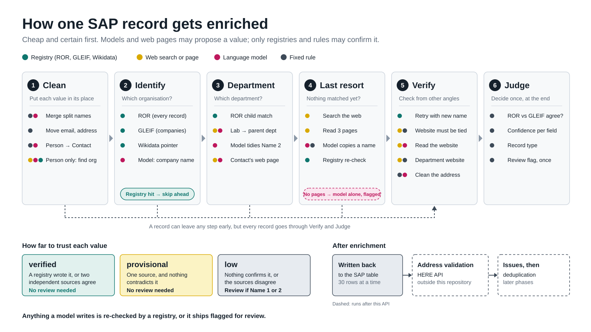
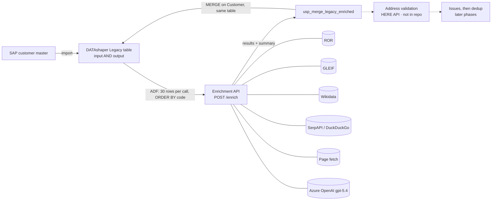
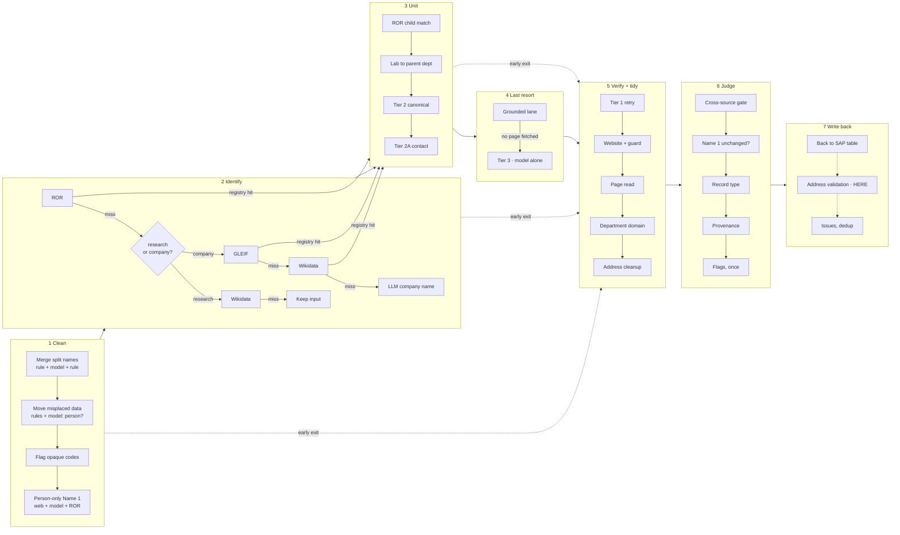
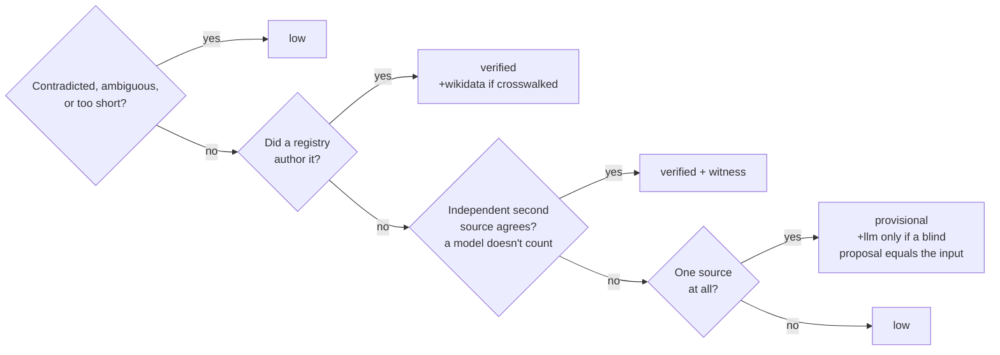
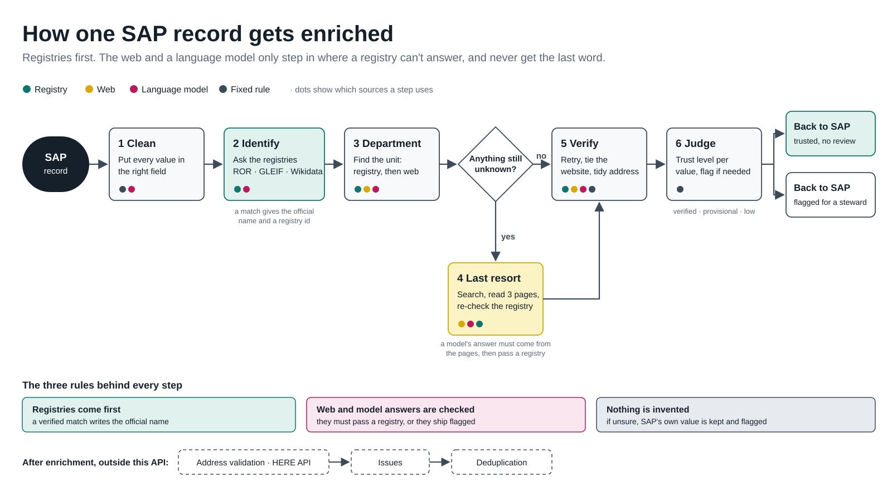
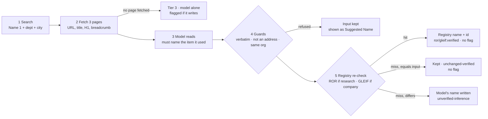
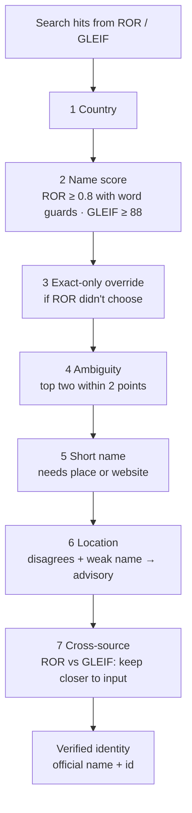
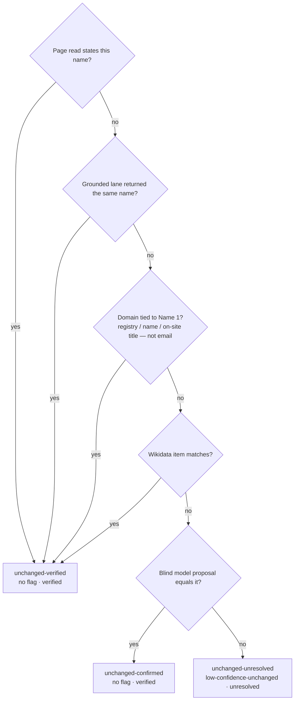
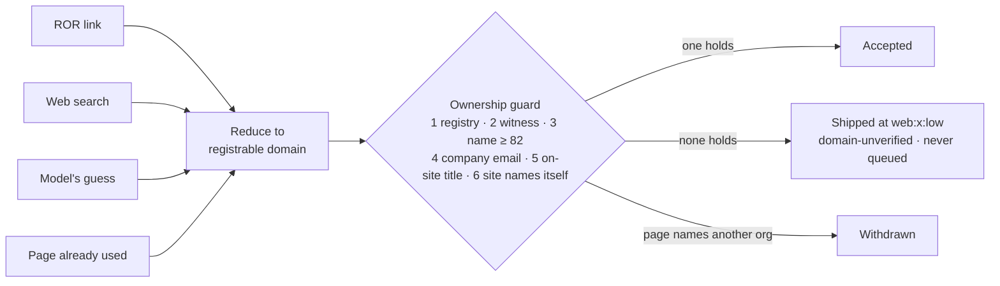

# Enrichment Walkthrough — the complete record of the explanation sessions

Compiled 2026-09-15 on branch `feature/llm-fixes` (code frozen before thesis submission).
This file collects everything explained in the working sessions about the SAP customer-master
**name enrichment** pipeline: the strategy, every path through the code, the guards, the
confidence and flag model, the Q&A, the memory aids and quizzes, the overflow-cost analysis,
and every figure produced (with its revision history).

Every claim here was read from the code at the time of the sessions. File references use
`path:line` as they stood on this branch. Where the README and the code disagree, the code
wins and the disagreement is listed in [§14](#14-where-the-readme-and-the-code-disagree).

---

## Contents

1. [How to use this file and where the figures are](#1-how-to-use-this-file-and-where-the-figures-are)
2. [The strategy in one sentence, and the principles](#2-the-strategy-in-one-sentence-and-the-principles)
3. [Where enrichment runs in production](#3-where-enrichment-runs-in-production)
4. [The per-record pipeline, in actual code order](#4-the-per-record-pipeline-in-actual-code-order)
5. [Routing: which branch a record takes](#5-routing-which-branch-a-record-takes)
6. [Clean: preprocessing and the overflow check](#6-clean-preprocessing-and-the-overflow-check)
7. [Identify: ROR, GLEIF, Wikidata and every registry guard](#7-identify-ror-gleif-wikidata-and-every-registry-guard)
8. [What happens when ROR misses a research institution](#8-what-happens-when-ror-misses-a-research-institution)
9. [Department (Unit) lanes](#9-department-unit-lanes)
10. [Last resort: the grounded lane and Tier 3](#10-last-resort-the-grounded-lane-and-tier-3)
11. [Verify: retry, website guard, page read, department domain, address](#11-verify-retry-website-guard-page-read-department-domain-address)
12. [Judge: confidence, the unchanged states, flags, status, Suggested Name](#12-judge-confidence-the-unchanged-states-flags-status-suggested-name)
13. [Batch consensus, and why it is not on the diagrams](#13-batch-consensus-and-why-it-is-not-on-the-diagrams)
14. [Where the README and the code disagree](#14-where-the-readme-and-the-code-disagree)
15. [token_sort vs token_set](#15-token_sort-vs-token_set)
16. [The overflow-check cost analysis and the code-freeze decision](#16-the-overflow-check-cost-analysis-and-the-code-freeze-decision)
17. [Memory aids: one sentence, seven verbs, six laws, trust ladder, journeys, guard cheat sheet](#17-memory-aids)
18. [Test yourself: 51 questions with answers](#18-test-yourself-51-questions-with-answers)
19. [The figures, in full, with their revision history](#19-the-figures-in-full-with-their-revision-history)
20. [Open caveats and things to verify before presenting](#20-open-caveats-and-things-to-verify-before-presenting)

---

## 1. How to use this file and where the figures are

| Figure | What it is | Local copy (this repo) | Published artifact (private until shared) |
|---|---|---|---|
| **Record Enrichment Map** | The full, detailed map of the pipeline: 7 columns, mixed-source dots, the funnel, plus panels on the website guard, the address, the trust ladder, three journeys and six rules | [`figures/enrichment-map.html`](figures/enrichment-map.html) | https://claude.ai/code/artifact/4c27fee0-344b-49c6-9f34-7928b2b5773b |
| **Enrichment Figure Set** | Eight presentation figures with a "say it like this" line each and a full-screen Present mode | [`figures/enrichment-figures.html`](figures/enrichment-figures.html) | https://claude.ai/code/artifact/df93dcc6-8319-4ef7-9074-68ffc2129870 |
| **Enrichment Slide** | One simplified 16:9 slide for the thesis PPT, plus insertion instructions and a 30-second script | [`figures/enrichment-slide.html`](figures/enrichment-slide.html) | https://claude.ai/code/artifact/ff7910d8-b6f0-47db-82eb-9611235fe008 |
| **Slide SVG** | The slide itself, standalone, for PowerPoint (Insert → Pictures → This Device) | [`figures/enrichment-slide.svg`](figures/enrichment-slide.svg) | embedded in the Enrichment Slide page (now inlined, so the page opens on its own) |
| **Enrichment Flow Slide** | A high-level **flow diagram** (boxes, arrows, one decision, two ends) for slides, with PPT instructions and a 30-second script | [`figures/enrichment-flow.html`](figures/enrichment-flow.html) | https://claude.ai/code/artifact/51caefc1-9869-450f-ad07-ee3b41bb51d0 |
| **Flow SVG** | The flow diagram itself, standalone, for PowerPoint | [`figures/enrichment-flow.svg`](figures/enrichment-flow.svg) | embedded in the Enrichment Flow Slide page |

Open the `.html` copies in any browser; they are self-contained apart from Google Fonts (they
fall back to system fonts offline).

The simplified slide, embedded:



**Colour language used in every figure** (it is the trust ladder, not decoration):

| Colour | Meaning | Light hex | Dark hex |
|---|---|---|---|
| Teal | Registry — ROR, GLEIF, a Wikidata pointer; can be `verified` | `#0F766E` | `#3CD3BF` |
| Yellow | Web search or a fetched page; at most `provisional` | `#D9A900` | `#F5D000` |
| Rose | Language model; flagged unless a registry confirms | `#BE185D` | `#F47AB8` |
| Slate | Deterministic rule | `#3D4A58` | `#B3BFCC` |
| Dashed outline | Runs outside this API / not in this repository | — | — |

A box with **one colour** uses one kind of source. A box with **dots** mixes sources — one dot
per step, in the order the steps run.

---

## 2. The strategy in one sentence, and the principles

> **Cheap and certain first, expensive and uncertain last. Models and web pages may *propose*
> a value; only registries and deterministic guards may *authorise* one. Every judgement is
> made once, at the end, from what the record actually holds.**

The README calls this a **tiered escalation approach** — start with the cheapest, most
reliable method and escalate only when it fails.

| Principle | What it means in practice |
|---|---|
| Deterministic before probabilistic | Regex cleanup and registry lookups run before any web search or LLM call |
| Registries are the authority | A verified ROR/GLEIF match writes the registry's official name. LLMs and web pages propose; they never outrank a registry |
| Never fabricate, never blank | If nothing can be established, the original value is kept and marked `input:low`. The pipeline never blanks a field it could not improve |
| Evidence, not history | Flags and confidence are derived from what the record finally holds, not from which tier happened to run |
| Structured extraction over free text | Page-reading prompts see URL path, title, H1, breadcrumb — not body text, where unrelated names live |
| Scope filtering | Department-level units are accepted; granular units (labs, groups, facilities) are not treated as departments |
| Transparency | Every result carries tier, source, confidence, domain, and four review fields (`flag_for_review`, `flag_codes`, `flagged_fields`, `flag_reason`) |

The problem it solves (README): SAP `Name1`–`Name3` hold abbreviations ("MIT", "Univ of
Florida"), misspellings, informal forms ("Dept of AI"), misplaced data (emails, streets,
contacts, AP references, SAP codes), overflow (one name split across two fields — "Adams Air" +
"Hydraulics Inc"), and incomplete records (blank department though a contact is known).

---

## 3. Where enrichment runs in production



| Fact | Detail | Evidence |
|---|---|---|
| Pipeline shape | Every ADF pipeline is `Lookup → Web activity → stored procedure`, chained on Succeeded; retry **0** everywhere | `docs/thesis/02_ARCHITECTURE.md` §2.2 |
| Batching | Enrichment pipeline: `Lookup2` emits one offset per 30 rows; `ForEach1` (sequential) pages `ORDER BY [code] OFFSET n FETCH NEXT 30`; each page is POSTed to `/enrich` and merged immediately | `adf/enrichment_pipeline.json:21,:46-50,:68,:105,:136` |
| In-call concurrency | `EnrichmentOptions.max_concurrency` default 5 records in flight (`asyncio.Semaphore`) | `enrichment/orchestrator.py:4513` |
| Already-enriched rows | A record arriving with `enriched = true` skips the pipeline and is echoed back; a record whose enrichment raised is not marked enriched, so the next run retries it | `orchestrator.py:4519-4552` |
| Legacy table is input and output | ADF reads `/enrich` input from the same table the merge proc writes | memory note; `sql/usp_merge_legacy_enriched.sql` |
| Merge blank-handling | 26 of 31 columns use `COALESCE(NULLIF(...), tgt)` — a blank keeps the old value. **`Record Type`, `ROR ID`, `LEI ID` overwrite unconditionally** (a run that misses clears a previously stored id); `Flag for Review` / `Flag Reason` overwrite directly by design | `usp_merge_legacy_enriched.sql:86`; ⚠-29 |
| Not written back | 37 of 69 response columns are never merged, including the Scheme B provenance columns, **`Flag Codes`** (the only source of `G3-NAME-006`, `G6-CONFIRM-001`, `G7-UNCHANGED-001`), `Flagged Fields`, `Operating Name`, `Suggested Name`, `Suggestion Source`, `Name 5`, `Error` | `02_ARCHITECTURE.md` §2.5 |
| Production workflow steps | 1 preprocess file · 2 DS import · 3 process legacy · 4 `/enrich` · 5 merge back · **6 address validation, auto write-back above 80% confidence (ADF pipeline not exported)** · 7 `/issues` · 8 validation · 9 steward review · 10 dedup cluster-block · 11 cluster review · 12 golden-record election | `docs/thesis/CONTEXT-EXTERNAL.md:416-429` |
| Address-validation service | Not reachable from any code in the repo; the address stage's only outbound call is the LLM. The vendor is not named in the repo — **"HERE API" comes from the project team** | `docs/thesis/06_EXTERNAL_DEPS.md` §2.9 |
| Evidence cache | Registry, SERP, page and LLM calls go through one evidence cache keyed on the request; a repeat run replays identical calls (LLM namespace keyed on the rendered prompt) | README "Fix B"; `llm/openai_client.py:435-437` |

---

## 4. The per-record pipeline, in actual code order

Read from `enrichment/orchestrator.py` (`_enrich_single` starts at `:7978`). A branch that
settles the record returns early through `_finalise_and_return`, so **every** record passes
through the same tail.

| # | Stage | Where | Trigger | What it does |
|---|---|---|---|---|
| 0 | **UC 0 overflow check** | `:8006` | every adjacent name pair, both filled and different | one LLM call per pair (on the **raw** SAP values); medium/high "yes" → merge the run, repack later |
| 1 | **Preprocessing (UC 6–12)** | `:8080` | always | regex cleanup; one optional LLM call to classify ambiguous plain names |
| 2b | **Person affiliation** | `:8299` | Name 1 held only a person | web snippets → LLM proposes institution → **ROR must confirm in the record's country**; short-circuits (Tier 3 never runs) |
| 2 | **Tier 1: ROR** | `:8327` | always, if Name 1 exists | affiliation endpoint → query endpoint, full guard chain |
| 2 | ROR hit on a company-typed org → **GLEIF** too | `:8521` | ROR said company | company counterpart |
| 2 | ROR hit → **child match** | `:8551` | Name 2+ | local `token_sort_ratio ≥ 70` against ROR children |
| 2 | ROR miss, **looks research** → **Wikidata crosswalk** → else passthrough | `:8583-8659` | keyword test | no GLEIF on this branch |
| 2 | ROR miss, **company** → **GLEIF** → **Wikidata** → **company canonical (LLM)** → GLEIF re-verify of a typo | `:8661-8756` | keyword test says not research | a registry hit skips the LLM |
| — | **AP short-circuit** | `:8874` | accounts-payable record | finalise now |
| 3 | **UC 13 lab → parent department** | `:8901` | Name 1 looks like a university **and** Name 2 is a lab (`is_lab_unit`) and ROR child match didn't already resolve it | on-domain SERP (or off-domain if no domain) → fetch 3 → LLM reads URL/title/H1/breadcrumb |
| 3 | **Tier 2 canonical** | `:9069` | `routing_type` ∈ {research, company} and a Name 1 exists | LLM normalises each department slot |
| 3 | **Tier 2A contact lookup** | `:9306` | university-looking Name 1, one contact, **known institution domain** | SERP on the person on-domain → fetch faculty page → LLM extracts department |
| 4 | **Grounded resolver** (replaced Tier 3) | `:9409` | anything left | search → fetch 3 → LLM must cite evidence → guards → registry re-check; degrades to **Tier 3** |

**The funnel — `_finalise_and_return` (`:7326`), in order:**

| Order | Step | Purpose |
|---|---|---|
| a | `_grounded_fallthrough` | an early return left Name 1 unresolved → offer it to the grounded lane (once, under `LLM_FALLBACK_AUTHORITATIVE`) |
| b | `_dept_fallthrough` | any unresolved department slot → grounded lane per slot (once) |
| c | `_name_post_checks` | e.g. drop a department that echoes Name 1 |
| d | `_retry_tier1_after_canonicalisation` | corrected Name 1 → ROR (and GLEIF on the company branch) once more |
| e | `_site_qualifier_retry` | try the name with a site qualifier stripped |
| f | `_retain_wikidata_website` | keep Wikidata's `P856` website claim before a candidate exists |
| g | `_maybe_resolve_website_bc` | website Path B (SERP) / Path C (LLM) → `resolve_domain` + ownership guard |
| h | `_corroborate_domain_from_wikidata` | compare `P856` with the candidate |
| i | `_corroborate_domain` | **page read** of the candidate site |
| j | `_probe_department_url` | department domain probe |
| k | `_check_liveness` | still exists? (ROR inactive, GLEIF retired, redirect away) — *removed from the diagrams at the user's request, still in the code* |
| l | `_run_address_stage` | address cleanup (rules + LLM for leftovers) |
| m | `finalise()` | cross-source gate, unchanged-Name-1 state, classification, provenance, **flags computed once**, casing, search terms, Suggested Name, grammar assertion |

After the whole batch is finalised, `enrich_batch` runs **batch consensus** (`:4562`) — see §13.



---

## 5. Routing: which branch a record takes

| Record looks like… | Identify branch | Department lanes eligible | Last resort |
|---|---|---|---|
| Research institution (ROR types education, healthcare, government, facility, nonprofit, archive, other) | ROR → child match; on a ROR miss: Wikidata crosswalk → passthrough | UC 13 lab resolver (university names), Tier 2 canonical, Tier 2A (needs domain) | Grounded lane |
| Company | ROR → **GLEIF** → Wikidata → LLM company canonical (a registry hit skips the LLM) | Tier 2 canonical, department fallthrough | Grounded lane |
| Person only in Name 1 | Person affiliation → ROR confirmation | Tier 2A on the confirmed domain | **None** — short-circuits, nothing can invent an institution |
| Accounts payable | — | — | short-circuits after preprocessing |
| Opaque code in Name 1 | not enriched | — | flagged `opaque-code` |

**After a ROR miss, "research" is decided by a keyword test**, `looks_like_research_institution(name1)`
(`orchestrator.py:8591`), because there are no ROR types to read:

| Name 1 | Keyword test | Branch |
|---|---|---|
| "Wayne State University School of Medicin" | University/School | research |
| "Harvard Medical School" | School | research — on purpose, so the company LLM cannot return "President and Fellows of Harvard College" (`:8584-8590`) |
| "NASA Ames" | no keyword | company → GLEIF → Wikidata → company LLM |

**Two fields, not one.** `routing_type` is provisional, updated as tiers report, internal only,
and gates the branches. `record_type` is decided **once** in `finalise` by `classifier.classify()`:

| Rank | Source | Yields | `record_type_source` |
|---|---|---|---|
| 1 | ROR org types | education/healthcare/government/facility/nonprofit/archive/other → `research_institution`; company → `company` | `ror` |
| 2 | GLEIF entity metadata | mainly `legalForm.id` (ISO 20275 ELF code, table in `elf_codes.py`); `category` is `GENERAL` for almost everything | `gleif` |
| 3 | Keyword heuristic | can only yield `research_institution` | `keyword` |
| 4 | Nothing | `unknown` — a real, legitimate fourth state | `unresolved` |

**The LEI guard:** an LEI alone never makes a record a `company` — universities, hospitals and
foundations hold LEIs (bonds, derivatives reporting). GLEIF's commercial verdict is withheld
when the name reads institutional. Tier 3 contributes no classification evidence.
A disagreement between routing and final type is counted (`routing_type_mismatch_count`), not re-run.

---

## 6. Clean: preprocessing and the overflow check

### 6.1 How preprocessing decides "street" vs "person" (`enrichment/preprocess.py`)

All regex; the only LLM involvement is one optional call for ambiguous plain names.

**Street / address** (`_ADDRESS_PATTERNS`, `preprocess.py:454-501`) — a value is address content when it matches:

| Pattern | Example |
|---|---|
| house number + words + street suffix (St, Ave, Blvd, Rd, Dr, Ln, Way, Hwy, Pl, Pkwy, Ct, Ter, Cir, Sq) | `600 N Wolfe St`, `235 E 42nd St` |
| house number + building word (Hall, Building, Bldg, Pavilion, Tower, Annex, Wing, Complex) | `100 Rhines Hall` |
| building word + room number | `Smith Building 200` |
| a bare street name with a suffix, as the whole value | `NW 2nd Ave` |
| Suite / Ste / Unit / Floor / Bldg / Building / Room / Rm + value (word boundary, so "United" and "Stevens" are safe) | `Suite 400` |
| floor in either order, only next to a 1–3 digit number (so "FL" = Florida is safe) | `5th Fl`, `Fl 3` |
| PO Box variants | `P.O. Box 12345`, `Mailbox 42` |

**Person** (`preprocess.py:1677-1858`), tried in order:

| Rule | How it decides | Deterministic? |
|---|---|---|
| A: `Attn:` / `c/o` prefix | explicit marker, with its own org-signal guard | yes |
| B1: title prefix | `Dr./Prof./Mr./Mrs./Ms./Rev./Hon.…` + 1–4 capitalised words; credentials (`PhD`, `MD`) stripped first | yes |
| B2: plain name | 2–3 capitalised words, **no org-signal word** → the LLM classifies person vs organisation | no (LLM) |

The **org-signal guard** (`_ORG_SIGNAL_RE`) blocks Inc, Corp, LLC, GmbH, AG, University, College,
Institute, School, Hospital, Center, Department, Division, Lab/Labs, Group, Research, Facility,
Core, Unit, Medical, Clinic, Foundation, Trust, Partners, Associates, Services, Systems,
Technologies, Sciences, Engineering, Office, Desk, Receiving, Shipping, Billing, Accounting,
Purchasing, Warehouse, Mailroom — so "Bell Labs" can never become a contact. `Smith, John` is
reordered to `John Smith` before classification; trailing credentials are stripped.
Multiple contacts are detected by `and`, `or`, `&`, `;`, `/`, ` + ` (a comma only when every part is a full name).

### 6.2 Use cases handled in Clean

| UC | Name | Action |
|---|---|---|
| 0 | Name overflow | LLM per adjacent pair; merge a split; repack to 32-char slots at the end |
| 6 | Accounts payable | normalise to "Accounts Payable"; AP in a street field is routed to the name block |
| 7 | Contact person extraction | person → `contact`; a person in **Name 1** triggers person affiliation (§5) |
| 8 | Email copy | **copied**, source preserved; a different existing address → `email-conflict` (both ship) |
| 9 | Address extraction | street fragments from name fields → street slots |
| 10 | Opaque code | cleared from Name 2–5, never from Name 1 → `opaque-code` |
| 11 | DBA normalisation | any "doing business as" variant → `DBA` |
| 12 | Duplicate slot clearing | runs **last** (sees normalised values); silent, no flag |
| — | Acronym + full form | `MIT Massachusetts Institute of Technology` → full form, only when the acronym is the verified initialism |
| — | Org/department in a street field | pipe-, comma- and single-value splits route org units to the name block; overflow → `overflow` flag, never silently dropped |
| — | Sub-locations | floor, room, c/o and Attn pulled into their own fields |

### 6.3 The overflow check (UC 0) — how it really behaves

Read from `enrichment/overflow_check.py:154-189` and `orchestrator.py:8006-8078`:

- **No pre-filter.** `run_overflow_check_block` loops over the four adjacent pairs
  (Name 1/2, 2/3, 3/4, 4/5) and makes **one LLM call per pair**, **sequentially**. A pair is
  skipped only if a slot is blank or the two values are equal after case/whitespace normalisation.
- It runs on the **raw SAP values, before preprocessing** — a pair whose lower slot is an email,
  a street or a person still costs a call.
- Only a medium/high "yes" counts (low is too noisy; false negatives are accepted by design).
- On a split: `merge_split_runs` joins the run (consecutive pairs chain: 1→2→3 becomes one value),
  packs the block leftward, and enrichment runs on the merged name. `*_original` columns still
  hold what SAP supplied. In `finalise`, `_repack_merged_name_block` re-cuts the settled names into
  pieces of ≤ 32 characters at word boundaries, filled from Name 1 down; a piece with no slot left
  raises `overflow` (never dropped). Only merged records are repacked; a repaired split carries no flag.

| Record | Calls |
|---|---|
| only Name 1 filled | 0 |
| "Stanford University" + "Department of Genetics" | 1 (answer: not a split — still asked) |
| Name 1–5 all filled and different | 4 |

The cost analysis and the decision about it are in [§16](#16-the-overflow-check-cost-analysis-and-the-code-freeze-decision).
On the diagrams this step is drawn as **rules + model**: rule (skip blank or equal pairs) → model
(is this one name?) → rule (merge, re-cut at 32 chars) — which is exactly the current code.

### 6.4 Person-only Name 1 (Stage 2b, `enrichment/person_affiliation.py`)

- **Snippets only, no page fetch.** Up to three SERP queries, first that returns results wins:
  `"Jane Smith" <email domain>` (non-consumer email), `"Jane Smith" <city, region, country>`,
  `"Jane Smith" university OR institute OR company OR hospital`. The LLM reads title, URL and
  snippet of the top 5 results, sorted by URL for determinism (`person_affiliation.py:151-155`).
- **ROR must confirm** the proposed institution in the record's country; only ROR's name, id and
  domain are written; department via Tier 2A on the confirmed domain, else the proposed one.
- Fail → contact kept, Name 1 empty, `person-unresolved`. Always short-circuits (no Tier 3).

---

## 7. Identify: ROR, GLEIF, Wikidata and every registry guard

### 7.1 ROR (`enrichment/tier1_ror.py`, `call_ror` at `:891`)

**Before the query:**

| Step | Why |
|---|---|
| US state expansion (`Fla State Univ` → Florida) | otherwise "_ State University" matches any state university (was matching Kent State) |
| Two-letter codes only in closed contexts (`FL State Univ`, `TX Tech`, `NJ Institute of Technology`); word-like codes (HI, IN, OR, OK, ME, LA, DE) not before bare `Tech` | "IN Laboratories" must never become "Indiana Laboratories" |
| Institution acronym map (`HFT` → Hochschule für Technik, `GA Tech` → Georgia Institute of Technology) | ROR has no such aliases; "Georgia Tech" would resolve to the Georgia Tech *Foundation* |
| Legal-suffix canonicalisation on both sides (Corporation→corp, Incorporated→inc…) | "Acme Corp." = "Acme Corporation" |
| Expansions never ship | the registry's official name is written, not the expanded query |

**Strategy A — affiliation endpoint** (`name, city, state, country`):

| Guard | Rule |
|---|---|
| `chosen` fast path | ROR's chosen item with score ≥ 0.8 goes through the guard chain |
| No `chosen` | only candidates whose name **equals the query word for word** (hyphens, `+`, `/` folded) are eligible (`:1184-1243`). Record 13348274 ("Galveston – University of Texas Medical") scored a University of North Texas candidate above threshold; a fuzzy override made it `ror:verified` with `unt.edu` and no flag |
| Ambiguity | top two peers within 0.02 → no match |
| **Local rescore** | re-scored with the local scorer (distinctive and acronym caps), must reach ≥ 0.8 (`:1301-1323`) |
| **Country guard** | candidate's `locations[0]` country must equal the record's ISO code; **a candidate with no country is rejected** (`_country_ok`, `:745`) |
| Locality + short name | see §7.4 |
| Acronym retry | same, with institution acronyms expanded |

**Strategy B — query endpoint:** country filter at the API, retry without it if empty; the country
guard re-filters **before ranking**; total order *exact name → score → token-count difference → ROR id*
(never API order); ambiguity margin 0.02 among **peers** (same exact/token tier — this is why
AstraZeneca is not refused because "AZHC Foundation" also scored 1.0); best < 0.8 → miss, and the
rejection log names the cap that caused it.

**The scorer** (`_compute_name_score`, `:378`, 0–1):
1. exact variant → 1.0;
2. every significant (≥ 4-char) query token found in a **display** name → 1.0 (blocked when the only tokens are location tokens, or a query acronym is missing);
3. substring at ≥ 90 % length → 1.0;
4. otherwise `token_sort_ratio` against display names only (aliases cause false positives: "SIU School of Medicine" vs "Yale School of Medicine"), with two **caps at 0.7**;
5. initialism fallback ("JAH VA Hospital" → James A. Haley Veterans' Hospital).

**Distinctive token** = a query token that is ≥ **4** characters, not in `_COMMON_DOMAIN_WORDS`
(regional, health, medical, center, centre, research, hospital, clinic, system(s), services, care,
university, college, institute, school, department, division, faculty, laboratory, laboratories,
labs, group, company, inc, corporation, corp, ltd, llc, gmbh, kgaa, sarl, intl, international,
national, american, united, global), not a connector (of, and, für, fuer, der, de, van, del…), and
not a location token from the record's city/state/country. **Every** distinctive token must be
"covered" by a candidate token — equal, a prefix (`univ` ↔ `university`), or a typo
(`_fuzzy_token_covers`: fuzz ratio above the spelling threshold, both ≥ 4 chars) — or the score is capped at 0.7.

| Query | Candidate | Result |
|---|---|---|
| Acme Biotech | AUM BioTech | `acme` uncovered → 0.87 capped to 0.7 (the case that moved the floor from 5 to 4) |
| Coastal Analytical Services | Analytical Services (ANSER) | `coastal` uncovered → capped |
| Newman Regional Health | Lakeland Regional Health | `newman` uncovered → capped |
| Massachusets Insitute of Technology | Massachusetts Institute of Technology | typos covered → passes |

**Acronym (identifier-token) guard:** tokens of 2–5 characters in all caps, including digit marks
(`3M`, `P66`); **every one must appear** in the candidate or the score is capped and the
subset/substring shortcuts are blocked. It fires **only when the query has case contrast** — in
all-caps SAP data ("BRIGHAM & WOMENS HOSP") every word would look like an acronym, so it switches
off (the distinctive-token and country guards still apply). Examples: "EMSL Analytical" vs "ASL
Analytical" → capped; "HFT Stuttgart" vs "Marienhospital Stuttgart" → blocked.

**Child matching:** once a parent matches, Name 2+ are compared locally against ROR children with
`token_sort_ratio ≥ 70`; a match writes the official child name (registry-owned).

**Registry names are authoritative:** a verified match writes the registry's official name via
`_write_registry_name`, with no second threshold. Registry names are never abbreviation-expanded or
re-cased ("Mayo Clinic FLA" → "Mayo Clinic in Florida").

### 7.2 GLEIF (`enrichment/tier1_lei.py`, `_best_verified_candidate` at `:284`)

Runs on the company branch (ROR miss + not research-looking, or ROR said company). Precise filter
(`filter[entity.legalName]`, ACTIVE, `legalAddress.country`) → fuzzy completions (resolves the
**5 smallest LEIs**, not the first 5 returned — order-independence).

| # | Guard | Rule |
|---|---|---|
| 1 | Country | record's country must match the **legal or HQ address**; post-filter on both paths, because `fuzzycompletions` cannot be country-filtered at the API |
| 2 | Name verification | `token_sort_ratio ≥ 88`, max of raw and legal-form-stripped (`_name_match_score`, `:132`); **not** `token_set` (§15) |
| 3 | Total order | ACTIVE first → region agrees → score → LEI |
| 4 | Ambiguity | winner vs runner-up within **2.0**; runner-up includes near-misses *below* 88, same status only, and not a candidate in another region when the winner's region agrees |
| 5 | Locality | compared (both addresses) and carried; never rejects by itself |
| 6 | Short name | needs a second signal; GLEIF has no website, so **only a consistent location** counts |

A verified match writes the legal name + `lei_id`; `confidence` high (precise) / medium (fuzzy);
`domain` stays null (no website field). A GLEIF failure never fails the record.

**GLEIF country guard — all the layers:** API filter on the precise path (`:636-637`); post-filter
on both paths (`:344-374`); by-id lookup for the Wikidata `P1278` crosswalk (`:825`); the grounded
lane's check that the registry's **stated** country equals the record's
(`grounded_resolver.py:497-508`); `name_gate._registry_country_conflict` at the write point.
ROR checks only its **primary** location; GLEIF accepts either registered address (Delaware
incorporation + real HQ). **Both skip the guard when the record has no resolvable country.**

### 7.3 Wikidata crosswalk (`enrichment/wikidata.py`)

Runs when ROR **and** GLEIF missed and there is no registry id — on the company branch after GLEIF,
**and on the research branch after a ROR miss** (`orchestrator.py:8611`). Principle: *Wikidata buys a
lookup key, not a value.*

- **Crosswalk:** the item carries `P6782` (ROR) or `P1278` (LEI) → the registry is re-queried **by id**
  with every guard; provenance is the registry's (`ror:verified+wikidata`).
- **Witness:** no pointer → may corroborate (unchanged-verified, domain condition 2 via `P856`), may
  write only `operating_name` (`wikidata:provisional`), **never** Name 1.
- **Gauntlet** (all mandatory, no SPARQL): `wbsearchentities` (labels + aliases, limit 5) →
  disambiguation page = no match for the whole record → type whitelist (22 QIDs, one `P279` step) →
  country must be US (**missing = reject**) → name via `_name_match_score` ≥ 88 → HQ city cross-check
  (missing `P159` neutral). More than one survivor = `wikidata_ambiguous` = no match. No LLM involved.
- Supersession: `P576` / `P1366` → `entity-superseded`; the name is never rewritten.
- A corroboration-only pass on registry-resolved records keeps only the `P856` claim.

### 7.4 Shared guards (`enrichment/registry_match.py`, `consistency.py`)

| Guard | Rule |
|---|---|
| **Short / collision-prone name** | ≤ 4 significant characters ("BIC", "3M") or one all-caps token ≤ 5 chars ("NABCO"); accepted only if the registry location is **consistent** (neutral does not count) or the candidate's website equals the record's domain |
| **Name-match tier** | `exact` (verbatim; forgives case, punctuation, an omitted legal form, an abbreviated one — "Huntsman Corp" = "HUNTSMAN CORPORATION"; never "Smith Inc" = "Smith LLC") / `fuzzy` / `short_name` / `crosswalk` |
| **Location action** (`location_check_action`) | contradicted + exact tier → traced only (`registry_location_unconfirmed`); contradicted + weaker tier → `registry-location-mismatch` (advisory). All addresses the registry publishes are compared; regions normalised (`US-TX` = `TX` = Texas) |
| **Cross-source gate** (in `finalise`) | ROR and GLEIF names compared with `names_agree` (ratio ≥ 88 **or** containment keeping the leading token). Agree → keep both, record the agreement, no flag. Disagree → keep the one closer to the record's **own supplied** Name 1; the loser's id, domain and acronym go → `source-conflict`. Motivating case: **BIC Corp** shipped GLEIF's correct LEI *and* a ROR id of a different company (Centene one run, Balchem the next) |
| **Write gate** (`name_gate.evaluate`) | at every name write: refuses address-like names, a registry country conflicting with the record, and any rewrite of a superseded entity |

Memory note: the conflict rule "keep the source whose name best matches the input" is implemented
for ROR vs GLEIF, not for registry vs web; the registry-vs-web branch of the gate was agreed for
deletion (it only fires on already-rejected registry matches). This was not re-verified in code
during these sessions.

### 7.5 Worked identity cases

| Input | Path | Output | Provenance / flag |
|---|---|---|---|
| `MIT` | ROR affiliation resolves the acronym | Massachusetts Institute of Technology, `ror_id`, `mit.edu` | `ror:verified`, no flag |
| `Mayo Clinic FLA` | ROR hit → registry name written unconditionally | Mayo Clinic in Florida | `ror:verified` |
| `Fla State Univ` | ROR-local state expansion | Florida State University (not Kent State) | `ror:verified` |
| `GA Tech` | acronym map → exact official name | Georgia Institute of Technology | `ror:verified` |
| `Pfizer AG` (CH) | ROR miss → GLEIF precise, ≥ 88, country guard | PFIZER AG + LEI; pension foundation refused (29) | `gleif:verified` |
| `Adams Air` + `HYDRAULICS INC` | UC 0 merge → Tier 1 on the merged name | Name 1 = Adams Air Hydraulics Inc | no flag for the repair |
| `Acme Biotech` (Tampa) | AUM BioTech capped 0.87 → 0.7 | no ROR match | guard rejection logged |
| `BIC Corp` | cross-source gate | GLEIF kept, ROR removed | `source-conflict` |
| `Celgene Corp` | GLEIF hit; liveness: ROR inactive + `celgene.com` → `bms.com` | name **not** rewritten to BMS | `entity-superseded` |
| corrected name after a miss | Tier 1 retry | official name + id | `tier1_retry_hit` marker |
| `BASF SE` (DE) | ROR affiliation returned the US "BASF" | refused by the country guard | — |
| `BHS` | Berkshire vs Behavioral Health Systems | refused (ambiguity / short name) | — |
| `Arkema Inc.` (NC plant) | GLEIF registered in PA, exact name | kept; noted in trace only | no flag |

---

## 8. What happens when ROR misses a research institution

`orchestrator.py:8583-8659` plus the funnel.

```
ROR miss + keyword says research
  1 Wikidata crosswalk — pointer to ROR/LEI? → re-query BY ID → registry writes name + id ✅
  2 else passthrough: Name 1 = input, source=passthrough, confidence=low, status=unresolved
    (not flagged yet — decided in finalise)
    no Name 2 and no contact → straight to finalise; else Tier 2 canonical on Name 2
  3 Grounded lane (main exit or _grounded_fallthrough): search → 3 pages → LLM cites → ROR ONLY
  4 Tier 1 retry if Name 1 was rewritten (ROR only on this branch)
  5 Website + ownership guard + page read (can corroborate the kept name)
  6 finalise: unchanged state decides status and flag
```

| Outcome | Condition | Name 1 | Status | Flag |
|---|---|---|---|---|
| Registry via Wikidata | pointer resolved | registry name | enriched | none |
| Registry via grounded lane | model read a page, ROR confirmed | ROR name | enriched | none |
| Evidence-backed, no registry | page cited, ROR missed | page value | enriched (SERP+LLM) | `unverified-inference` |
| `unchanged-verified` | kept, independently corroborated | input | verified | none |
| `unchanged-unresolved` | kept, nothing corroborates | input | unresolved | `low-confidence-unchanged` |
| Tier 3 guess | grounded lane degraded, Tier 3 wrote | model value | unresolved | `unverified-inference` |

The code comment's example: "Wayne State University School of Medicin" missed ROR at 0.70 because
of the truncation; Name 3 resolving used to mark the record enriched so Name 1 was never re-asked —
which is why `_name1_unresolved` asks about Name 1 specifically (`:6944-6981`).

**What a research record loses on a ROR miss:**

| Lane | Needs | Runs? |
|---|---|---|
| ROR child match | a ROR parent | ✗ |
| UC 13 lab → parent | university-looking Name 1 + a lab in Name 2 | ✓ (off-domain query when no domain) — *corrected: it does not need a Tier 1 match* |
| Tier 2A contact | `institution_domain` (`:9066`) | ✗ — always None here unless the crosswalk hit |
| Tier 2 canonical | `routing_type` + a Name 1 (`:9074`) | ✓ |
| Department fallthrough | — | ✓ |
| Department domain probe | a domain (may come from the website step) | ✓ if a domain was found |

**Two findings for the thesis:**
1. **GLEIF is never queried directly for a keyword-research record** — first pass, grounded
   re-verify (`grounded_resolver.py:446-447`, order `("ROR",)`) and Tier 1 retry all ask ROR only.
   An LEI is reachable only through a Wikidata `P1278` pointer. Deliberate, but hospitals and
   university systems holding LEIs lose one registry check.
2. **Tier 2A never runs on a research ROR miss**: it needs a domain, and the domain is resolved in
   finalise, after Tier 2A was skipped.

**Why there is no LLM "university canonical":** the company-canonical model returns legal-entity
names ("President and Fellows of Harvard College" for "Harvard Medical School"), so research names
skip it and go to the grounded lane, which reads the web and re-checks with ROR.

---

## 9. Department (Unit) lanes

| Situation | Lane | Result | Flag |
|---|---|---|---|
| `Dept of Chem` at Stanford, ROR has that child | ROR child match (local, ≥ 70) | Department of Chemistry (registry-owned) | none |
| Informal Name 2, no ROR child | Tier 2 canonical (LLM) | written if the **subject is preserved** and it is not a prefix downgrade; confidence travels as provenance (§1a — confidence is no longer the gate) | selective, by reported confidence |
| Name 2 blank, one contact, domain known | Tier 2A **Mode A** (population) | department read off the contact's faculty page | `dept-via-contact` |
| Name 2 present, one contact | Tier 2A **Mode B** (verification) | fuzzy ≥ 95 → `verified` status; ≥ 60 → partial; < 60 → correction | partial / no-match flagged |
| Name 2 is a **lab** (`NMR Spectroscopy Group` at MIT) | UC 13 lab → parent | Name 2 = parent department, lab moved to Name 3 (or next free slot) | `dept-via-lab` |
| Lab, but every lower slot is full | UC 13 | parent written, lab not demoted | `name3-not-demoted` |
| Contact names two people | Tier 2A skipped | unchanged | `multiple-contacts` |
| Name 2 == Name 1 | finalisation Rule 3 | Name 2 dropped | none |
| Name 2 blank, no contact | nothing runs | stays blank — **never fabricated** | **none** (an absent department is not a defect) |
| Still unresolved | `_dept_fallthrough` (grounded lane per slot) | SERP + page read + the same write gate | by evidence |
| Administrative desk ("Accounts Payable") | skipped by `has_no_canonical_form` | kept as supplied | none |

**UC 13 details** (`enrichment/lab_resolver.py`): labs only (lab, labs, laboratory, laboratories — not
groups, centres, cores, facilities; `orchestrator.py:8908-8911`); academic institutions only
(`looks_like_university_or_research_institute` on Name 1 — a lab at Merck, a NASA centre or a
hospital lab has no academic department above it); skipped when ROR child match already resolved
Name 2. Query with a domain: `"<lab>" department site:<domain>`, keep only URLs containing the
domain; without a domain: `"<institution>" "<lab>" department`, any result. Fetch the top 3; the
LLM reads **URL path, title, H1, breadcrumb only**, and may answer only "Department/Division/School/
College/Faculty/Institute of X". Best pick: confidence, then longer name, then alphabetical.

**Tier 2 canonical is not only for universities.** `can_canonical` is true for
`routing_type in ("research_institution", "company")` (`orchestrator.py:9074`). But the prompt is
academic — *"You normalise user-supplied academic department names…"*, answers like "Department of X",
and it labels the institution "(verified)" even when nothing verified it (`llm/prompts.py:199-229`).
A company Name 2 ("Analytical Sciences" at Pfizer) goes through an academic-department prompt;
the subject-preserved and no-downgrade guards stop outright swaps, but the framing does not fit
companies — **a gap worth stating**. DBA-marked slots and admin desks skip the LLM.

**Tier 2B** (department web search) is documented in the README but **no longer called** by the
orchestrator (only the `tier2b_count` counter remains, `:9589`); department web search now runs
through the grounded lane via `_dept_fallthrough`.

---

## 10. Last resort: the grounded lane and Tier 3

### 10.1 The grounded lane, step by step (`enrichment/grounded_resolver.py`)

Entry points: the main exit where Tier 3 used to be (`orchestrator.py:9409`), `_grounded_fallthrough`
(Name 1 unresolved after an early return), `_dept_fallthrough` (once per unresolved department slot).
The two fallthroughs run only under `LLM_FALLBACK_AUTHORITATIVE` (default `true`, `config.py:240`).

**A. Query** (`build_query`, `:329`): `"<Name 1>" <core subject of Name 2> <city> <state>` —
"Department of Chemistry" contributes only "Chemistry".

**B. Evidence** (`_gather_evidence`, `:361`): SERP 5 results (country-scoped), fetch the top **3**.
Each evidence item = URL + search title + snippet + (if fetched) **page URL path, title tag, H1,
breadcrumb** — body text is deliberately never shown. Degrade to Tier 3 when the SERP is empty
(`serp_empty`) or **not one page could be fetched** (`all_fetches_failed`), or the LLM call fails.

**C. The model reads** (`prompts.py:552-613`). System prompt: *never use knowledge that is not in the
evidence*. It returns `name1_canonical`, `name2_canonical`, `name2_kind` (department | sub_entity |
alias_of_name1 | person | noise), `per_field_confidence` (describing the **evidence**: high = stated
outright), `evidence_index` (which item supports each name, or null), `reasoning`. It is told to
**repair** — expand "UTSW", "Hosp", "Visn", "Med Ctr", complete truncations, fix typos — and never to
return a different company, a parent or a subsidiary.

**D. Name 2 kind:** department / sub_entity / unclassified → proposal; `alias_of_name1` / `noise` →
Name 2 **cleared**; `person` → left untouched.

**E. Deterministic guards, before any registry query** (`:640-689`) — so a wrong name is never used
as a registry query ("Liberty Health Sciences" must not acquire ROR's "Liberty Science Center"):
- address-like (street, postcode, copied street);
- **verbatim containment** — the proposal must appear as a substring of the rendered evidence
  (only case, punctuation and whitespace forgiven); stops composed names like "Veterans Affairs
  Medical Center Redding" built from "Veterans Affairs" + "Redding VA Clinic";
- identity (Name 1): `different` → refused; `same` / `undecidable` → proceed.
A refused proposal becomes a **suggestion** (Suggested Name); the input stays.

**F. Registry re-verification** (`_re_verify`, `:408-523`): research → ROR only; company → GLEIF only;
unknown → both (ROR first if the name looks institutional). Full client guards, plus the registry's
**stated** country must equal the record's, and a Name 2 match must not return Name 1's own id.

**G. Outcomes per field:**

| Outcome | Condition | Result |
|---|---|---|
| Registry hit | a registry matched the proposal | written twice (model's name, then the official name over it); column reads `ror:verified` / `gleif:verified`; id and domain attached; **no flag**; `enriched` |
| Confirmed | no hit, proposal = input under `normalize_key` | **nothing written**; `_ev_grounded_confirmed_name1` → `unchanged-verified` in finalise → no flag, status `verified` |
| Adopted | no hit, proposal differs | model's name written, producer `llm_grounded` → **`unverified-inference`** (`llm_grounded` is an evidence-free producer *even when a page was read*, `provenance.py:1019-1024`), except casing-only or pure-repair changes; `SERP+LLM` / `enriched` with a cited page, `LLM` / `unresolved` without |
| Refused | a guard refused it | input kept; candidate → Suggested Name; `low-confidence-unchanged` |
| Nothing | model returned nulls | `passthrough` / low / unresolved |

**H. Applied to the record** (`_apply_grounded`, `orchestrator.py:5595`): `name_gate` runs again at the
write point; a department matched in a registry must be anchored to this record or the registry id is
dropped; a Name 2 registry id goes to internal `name2_registry_id`, never `ror_id`; **`tier_used`
stays 3 even on a registry hit** (evaluation tier counts are not inflated — `source` shows ROR).

**Caveats about the "confirmed" rung** (it ranks right under the page read in `unchanged_state.resolve`):
- at least one page must have been fetched, but containment is checked over **all** rendered
  evidence, snippets included — the name can come from another result's snippet; the `source_url`
  is stored only when the model cites an item, otherwise the evidence label is just `page:grounded`;
- the page does not have to be the organisation's **own** site. The domain rung has
  `_serp_label_relates` (added after an NLRB case page "verified" ExxonMobil); no equivalent check was
  seen on this rung — a directory or news page mentioning the name could confirm it (reasoned from
  the code path, not tested).

### 10.2 Tier 3 — the model alone (`enrichment/tier3_llm.py`, `_apply_tier3` at `orchestrator.py:4072`)

Runs **only as the grounded lane's fallback** at the main exit. The model gets every name slot, the
contact and the full address, with **no search results or pages** ("Infer official org and dept
names…"); the prompt even encourages a best-guess department (`prompts.py:435-480`).
*(The diagrams call it "Tier 3 · model alone" — not "memory", which could suggest special training.)*

| Stage | Name 1 | Department slots |
|---|---|---|
| LLM call fails | nothing; status `failed` | — |
| Confidence | **not a gate** — any band proceeds (`authoritative=True`) | same |
| Address guard | dropped if postcode / house number + street type / ≥ 50 % overlap with the street | same |
| Same as current value | not written (keeps e.g. GLEIF's provenance) | — |
| Identity | `name_gate.evaluate`: different → refused → Suggested Name; same/undecidable → written | a filled slot must keep its subject (`subject_preserved`) — "Edwards Air Force Base" → "412th Test Wing" refused; a blank slot has no check |
| Write | producer `llm_tier3` | marked `_from_tier3` |

Then in finalise: no department signal (no department and no contact in the input) → **every**
department slot cleared (`:9487-9505`); a slot preprocessing emptied cannot be refilled; an invented
department (blank input, only Tier 3, confidence not high) is **dropped** (`_is_droppable_tier3_guess`,
`:2556`); the **Tier 1 retry** re-queries the registry with the new Name 1 and a hit overwrites it and
clears the flag; any field Tier 3 last wrote gets **`unverified-inference`** ("inferred without external
evidence — confirm against an authoritative source"); status `unresolved`, source `LLM`, tier 3;
batch consensus (registry mode) retracts `unverified-inference` when a donor supplies the name.

**Is there a final "just ask the LLM" step?** Only as that fallback. If the grounded lane ran and
established nothing, no model-only call follows — the record stays a passthrough.

### 10.3 The two fallthroughs

| | `_grounded_fallthrough` (`:7243`) | `_dept_fallthrough` (`:7086`) |
|---|---|---|
| Fixes | early returns ("this branch has nothing more") were read as "record finished" though Name 1 was never resolved — 37 records | a department only ever got ROR child matching; e.g. "Texas Heart Inst" under Baylor ended with no search |
| Fires when | `_name1_unresolved`: no ROR/LEI id, no registry-named field, not failed, no verdict yet, Name 1 still equals its input | per slot: has a value, not registry-written, no verdict, not an admin desk |
| Does | grounded lane on Name 1 | grounded lane on Name 1 + that slot, same write gate |

---

## 11. Verify: retry, website guard, page read, department domain, address

### 11.1 Tier 1 retry after canonicalisation (`_retry_tier1_after_canonicalisation`, `:6092`)

Trigger: `name1_enriched` differs from the string Tier 1 was queried with, under `normalize_key`
(punctuation/case differences do not buy an API call); skipped when an id exists or Tier 1 never ran.
Once per record; **no guard relaxed**; ROR first, GLEIF only on the company branch. On a hit: official
name, id, `tier_used = 1`, marker `tier1_retry_hit`; registry provenance also re-qualifies a domain.
Measured (chemspeed 100): reached on 100/100 records; 18 of 25 LLM-authored names skipped as
punctuation-only, 7 fired and missed both registries — yield bounded by GLEIF coverage of US SMBs.

### 11.2 Website and the single domain write path (`utils/domain_resolver.py`)

Candidate order (first accepted wins, never overwritten): **Path A** ROR's website link →
**Path B** SERP `"{name1}" official website` + geo, ranked 0/1/2 by distinctive name tokens in the
**host** (title-only overlap = rank 0 = rejected; a blacklist of wikipedia/linkedin/…; one unquoted
retry) → **Path C** an LLM guess (always `low`) → a `source_url` from Tier 2A / the lab resolver.
Every candidate is reduced to the registrable domain (`http://www.uni-stuttgart.de/home/index.en.html`
→ `uni-stuttgart.de`; `admission.gatech.edu` → `gatech.edu`) and judged by the **ownership guard**:

| # | Condition (checked in this order; first that holds wins) | Example / provenance |
|---|---|---|
| 1 | A registry supplied it (ROR after its guards; GLEIF after verification) | `ror:verified` |
| 2 | An independent source names the same site — ROR `links[]` or Wikidata `P856` equal the candidate | the only web-found domain that reaches `verified`: `web:x:verified+wikidata` / `+registry` |
| 3 | Name 1 vs the domain label, `token_sort_ratio ≥ 82` (`DOMAIN_NAME_MATCH_THRESHOLD`) | `lockheedmartin.com` 82.4 ✓ · `aumbiotech.com` 81.8 ✗ (the two values that set 82) |
| 4 | The record's own non-consumer email domain (replaces an unverifiable candidate) | `orders@meridianlabs.com` → `meridianlabs.ai`; gmail/outlook/yahoo/… never count |
| 5 | An on-domain SERP result whose title/H1 contains **all** significant Name 1 tokens | — |
| 6 | Page identity — the site states this organisation's name and does not place it in another state/country | at most `provisional` (a site vouching for itself is one source) |

**None holds** → the candidate **still ships**, at `web:x:low` with `domain-unverified` (advisory: shown,
never queued); `website_url` stays empty. Most such candidates are right but unprovable
(`fishersci.com`). **Exception:** if the page read found a *different* organisation, the domain is
withdrawn and never returns (`johnsoncontrols.com` for "AB Controls, Inc."). Known cost: contractions
(`massgeneralbrigham.org`) and bare acronym hosts (`ufl.edu`) are unreachable by name similarity.
The guard exists because the old path attached `delta.com` to "Delta Analytical" and
`cardinalhealth.com` to "Cardinal Instruments".

### 11.3 Page-read corroborator (`enrichment/page_corroborator.py`)

Runs when there is a candidate and the record is **not** registry-resolved. Fetches the root plus the
first 2xx of `/impressum`, `/legal`, `/about`, `/contact`, and the footer explicitly (copyright line).
One LLM call as a constrained reader → `stated_org_name`, city, region, country, postal code, legal
form (nulls when the page states nothing). Rules: **a page is a witness, never an author** (it writes
`operating_name`, never Name 1); **silence is not evidence** (403, bot wall, parked, timeout = could not
look); no new similarity machinery (`names_agree`).

| Outcome | Condition | Consequence |
|---|---|---|
| `corroborated` | name consistent, location consistent or silent | `domain-unverified` withdrawn, candidate accepted (condition 6, provisional), `operating_name` written; feeds `unchanged-verified` |
| `contradicted` | name consistent, stated location differs | recorded; decides only at region/country granularity (`ACTIONABLE_LOCATION_SCOPES`) |
| `name_mismatch` | page names another organisation | an accepted domain is **withdrawn** (the only place a domain is removed) |
| `fetch_unavailable` / `parked` / `no_identity` | could not look, or nothing stated | no change |

**Containment** (`names_agree_by_containment`): agree when one name's distinctive tokens are a subset
of the other's **and** the subset keeps the longer name's **leading** token — "Stryker Orthopaedics" ⊃
"Stryker" agrees; "Owens Corning Sales" ⊃ "Corning" and "Thermo Fisher Scientific" ⊃ "Fisher
Scientific" are refused. Used by the page read and the cross-source gate, **not** for GLEIF acceptance.

### 11.4 Department domain probe (`_probe_department_url`)

Stages: constructed subdomains (`chem.ufl.edu`) → homepage link scrape → site-restricted SERP →
on-domain path page → cross-domain SERP (off by default). Guards: generic/service hosts are never a
department (`news`, `digitalcommons`, `catalog`, `libguides`, …, §5g); never the organisation's own
domain (§5h); **the shipped host must name the unit** (§5i) — replayed over 40 eval department
domains, 12 survive and 28 are dropped. Output is `https://<host>`; a path-only department ends `None`.

### 11.5 Liveness (in the code, removed from the diagrams)

`_check_liveness` raises `entity-superseded` from ROR `status: inactive`, GLEIF `INACTIVE`/`RETIRED`, or
a website redirecting to a domain naming a different organisation (`celgene.com` → `bms.com`,
threshold 60). `LAPSED` (35 % of all LEIs) is deliberately not a signal. It never rewrites a name.
The user asked for it to be deleted from the diagrams; it remains in the code.

### 11.6 Address cleanup (`enrichment/address_processing.py`, `_run_address_stage` at `:7829`)

Runs on every return path inside the funnel. Clean (trim, stray punctuation) → Extract (PO box, suite,
building, floor, room, unit, mail stop, c/o, unloading point, mail codes; split a whole address jammed
into one line) → Cross-check (duplicates, conflicts, names inside street lines — flag only) → **LLM only
for residual Street 2–5 values** that don't read as an address (high confidence acts, low only reports)
→ Normalise (Street → St, North → N). **No external address service is called.** Validation with the
HERE API happens later, as production step 6, outside this repository (§3).

---

## 12. Judge: confidence, the unchanged states, flags, status, Suggested Name

### 12.1 Provenance Scheme B and the one confidence function (`enrichment/confidence.py`)

```
provenance := source ":" confidence ( "+" witness )?
source     := input | ror | gleif | wikidata | llm | web:<domain>
confidence := verified | provisional | low
witness    := web | wikidata | llm | registry | domain | dba
```

`compute_confidence` checks, in order:



Hard rules: (1) `llm` as source or witness can never produce or contribute to `verified`; (2) a
witness-less `verified` is legal only for a registry; (3) rejected evidence never appears in provenance.
The old scheme (`producer:tier:method`, e.g. `ror:1:exact`, `llm_tier3:3:self_medium`) exported the
mechanism instead of the claim and was replaced.

### 12.2 The three unchanged-Name-1 states (`enrichment/unchanged_state.py`)

Only **`unchanged-unresolved`** produces "left exactly as supplied" (`flagged` is
`state == UNCHANGED_UNRESOLVED`, `:153-155`). `resolve()` checks in order, first that holds wins:

| # | Check | State |
|---|---|---|
| 1 | Page read of the candidate site corroborated the name | verified |
| 2 | Grounded lane searched, read, and returned the same name | verified |
| 3 | Accepted domain tied to Name 1 by ownership condition `name`, `registry` or `serp` (serp only if the label resembles the name ≥ 60; not if the page read said `name_mismatch`); **email excluded** | verified |
| 4 | Wikidata item passed type, country, name, HQ | verified |
| 5 | Company-canonical proposal, made without seeing the answer, equals the input under `normalize_key` | confirmed |
| 6 | none | **unresolved → flagged** |

| State | Provenance | Status | Flag |
|---|---|---|---|
| `unchanged-verified` | `input:verified+web` / `+wikidata` / `+registry` | `verified` | none |
| `unchanged-confirmed` | `input:provisional+llm` | `verified` | none |
| `unchanged-unresolved` | `input:low` | `unresolved` | `low-confidence-unchanged`: *"left exactly as supplied — the canonical form could not be established with enough confidence to rewrite it; confirm the value is correct"* |

Edge cases: a record that never reached Tier 1 (opaque code) gets none of the three; email says which
organisation the *record* belongs to, not whether the Name 1 *string* is its name; batch consensus
can withdraw the flag; **Name 2** gets `low-confidence-unchanged` via a separate marker with no
verified/confirmed escape (admin desks exempt). The flag is derived from provenance — a tier trying to
raise it directly gets a `ValueError` (`flags.py:835-844`).

### 12.3 Status, the review flag, and the codes

| Status | Meaning |
|---|---|
| `enriched` | Name 1/2 enriched with sufficient confidence |
| `verified` | confirmed correct (Tier 2A exact match, or unchanged-verified/confirmed Name 1) |
| `unresolved` | attempted, not confident enough — manual review |
| `failed` | pipeline error |

```
flag_for_review := any(Name 1 or Name 2 confidence == low)  OR  any non-advisory code
advisory (shown, never queued): domain-unverified, registry-location-mismatch
```

A populated `Flag Reason` with `flag_for_review = false` is valid and common. Core fields are Name 1
and Name 2 only (including Record Type would take the reference batch from 55 flagged rows to 96).

| Code | Raised when | Scope |
|---|---|---|
| `no-match` | every tier failed; suppressed when any other code applies | name1 |
| `low-confidence-unchanged` | **derived**: a core field is `low` | the low field(s) |
| `unverified-inference` | a model wrote the value without registry confirmation | written fields |
| `source-conflict` | the cross-source gate removed one of two disagreeing registries | name1 (+domain) |
| `entity-superseded` | liveness or Wikidata says the organisation no longer exists | name1 |
| `dept-via-lab` / `dept-via-contact` | department inferred from a lab page / from the contact's affiliation | name2 (+name3) |
| `name3-not-demoted` | UC 13 found no free slot for the lab | name2…name5 |
| `person-unresolved` | a person in Name 1 whose affiliation could not be resolved | name1 |
| `overflow` | name/street content with no slot left | the affected slots |
| `opaque-code` | Name 1 holds an internal code | name1 |
| `domain-unverified` | the candidate failed every ownership condition (still shipped) — **advisory** | domain |
| `email-conflict` | more than one email; both ship | email |
| `multiple-contacts` | contact names more than one person | contact, name2 |
| `registry-location-mismatch` | registry locality contradicts a weakly-matched record — **advisory** | address |
| `relocated-unverified` | preprocessing moved content into a slot and nothing vouched for it | that slot |

**Deliberately not flagged:** guarded registry matches (incl. person affiliation); evidence-backed
Tier 2A/2B writes; high-confidence canonicalisation; deterministic normalisation; a blank department
that stayed blank; a kept-and-corroborated Name 1; batch-consensus inheritance.

### 12.4 Suggested Name, search terms, casing, changed flags

- **Suggested Name** (`orchestrator.py:3333-3365`): one value per record, **only when `flag_for_review`
  is true**, elected from refused proposals by evidence weight — a registry match refused (e.g. ROR's
  non-exact candidate, a country conflict) > a web-lane proposal refused > a model proposal refused;
  ties by collection order; a value equal to the shipped Name 1 is skipped. `Suggestion Source` =
  `"<lane>, refused: <reason>"`. Steward-facing only: no provenance, read by nothing downstream,
  not merged back to SQL.
- **Search terms**: uppercase, ≤ 32 chars (SAP SORT1/SORT2), derived only from enriched values —
  ST1: currency-checked ROR acronym → TLD-stripped domain → name handle; ST2: `ADMIN` for admin
  desks → subdomain acronym → Name 2 phrase without unit words → department host.
- **Casing** (Rule 7): token-level, every exit path, registry names skipped; casing never sets a
  changed flag (on 500 records flags would go 270 → 490).
- **Registry names** skip abbreviation expansion and casing.

---

## 13. Batch consensus, and why it is not on the diagrams

**What it does** (`enrichment/batch_consensus.py`, called at `orchestrator.py:4562`): after every record
in one `/enrich` call is finalised, rows naming the same organisation at the same address share
organisation-level fields. It **fills gaps only** — never merges, drops or reorders rows.

| Question | Answer |
|---|---|
| Who groups | same address (SHA-1 of country, postcode, street, house number) **and** the same base Name 1 with a **compatible legal form** (identical after canonicalisation, or absent on one side). "Delta Analytical Inc" and "…LLC" stay apart; a row with no street or postcode never groups |
| One registry id in the group | the donor (most ids → earliest tier → earliest position) wins outright: `ror_id`, `lei_id`, Name 1, domain, website, record type |
| No registry id | only fields every member already agrees on are filled; Name 1 takes the modal spelling, a tie goes to the spelling closest to the originals SAP supplied (Coastal trio → "Coastal Diagnostics, Inc") |
| Two different ids | nothing moves, no flag, counted only |
| Never shared | Name 2–4, department domain, contact, care-of, email, search term 2, address — three Stanford rows share Stanford's id and domain but keep their own departments |
| Bookkeeping | `tier_used` kept (never set to 1), `source` = `batch_consensus`; withdraws only the codes its own Name 1 write made untrue (the derived low in both modes; `no-match` and `unverified-inference` only under registry consensus) |

**Why it was removed from the diagrams** (the user's point, confirmed): it only compares rows inside
**one API call**. Production ADF sends **30 rows per call, ordered by customer code**, so across
~100k records two rows for the same organisation rarely share a call. It does act on whole-workbook
runs (the `/enrich/file` upload and `scripts/run_batch.py`, which pass the whole workbook to
`enrich_batch`). Making records agree across the full dataset is the **deduplication phase's** job,
which receives the whole group code in one call. The map keeps a short note explaining the omission.

---

## 14. Where the README and the code disagree

| README says | Code does |
|---|---|
| Tier 3 (pure LLM) is the last resort | the **grounded resolver** runs there (`orchestrator.py:9409`); plain Tier 3 only when it degrades; `LLM_FALLBACK_AUTHORITATIVE` defaults `true` (`config.py:240`) |
| Tier 2B department search is live | **not called** anywhere in the orchestrator; only the `tier2b_count` counter remains (`:9589`); department search goes through `_dept_fallthrough` |
| Tier 2A, then Tier 2 canonical, then 2B | code order: UC 13 → Tier 2 canonical → Tier 2A |
| Tier 2 canonical needs a ROR parent and accepts only high confidence | needs only `routing_type` + a Name 1; confidence is recorded, identity decides (§1a) |
| UC 13 fires on any granular unit and needs a Tier 1 match | labs only; university-looking Name 1; works without a domain (off-domain query) |
| Tier 3 writes only high/medium | any confidence proceeds under `authoritative=True`; identity decides |
| `verified` status only from Tier 2A Mode B | also from `unchanged-verified` / `unchanged-confirmed` (the README says so in another section) |
| (memory) the cross-source gate's registry-vs-web branch was agreed for deletion; README still says "a registry outranks the web, always" | whether that branch is still in `consistency.py` was not re-checked |

---

## 15. token_sort vs token_set

Both compare **words**, not characters, and both ignore word order. They differ in what happens to
the **extra words** only one name has:

- **`token_sort_ratio`** — sort each name's words alphabetically, rejoin, compare the two strings by
  edit similarity (0–100). Extra words **cost** points: it asks *"are these the same name?"*
- **`token_set_ratio`** — split into shared / A-only / B-only word sets, compare *shared* with
  *shared + A-only* and *shared + B-only*, keep the best. If every word of one name is inside the other,
  "shared" *is* the shorter name, compared with itself → **100**: it asks *"is one name inside the other?"*

Scores computed with the project's rapidfuzz; "pipeline" = `_name_match_score` = max(token_sort raw,
token_sort with legal forms removed):

| A | B | sort | set | pipeline | same organisation? |
|---|---|---|---|---|---|
| pfizer ag | personalvorsorgestiftung der pfizer ag in liquidation | **29.0** | **100** | 29.0 ✗ | **no** — a pension foundation in liquidation |
| thermo fisher scientific | fisher scientific | 82.9 | **100** | 82.9 ✗ | **no** |
| coastal diagnostics inc | diagnostics inc | 78.9 | **100** | 78.9 ✗ | **no** |
| novartis | novartis ag | 84.2 | 100 | **100** ✓ | yes (dropping "AG" makes them equal) |
| acme widgets inc | acme widgets incorporated | 78.0 | 85.7 | **100** ✓ | yes |
| florida state university | university state florida | 100 | 100 | 100 ✓ | yes (order ignored by both) |
| bayr ag | bayer ag | 93.3 | 93.3 | 93.3 ✓ | yes (typo) |
| stryker orthopaedics | stryker | 51.9 | 100 | 51.9 ✗ | **yes** — token_sort misses it |

**Why GLEIF uses token_sort:** GLEIF's search is full-text; it returns every entity whose name
*contains* the query (foundations, pension trusts, subsidiaries, entities in liquidation). With
token_set they would all score 100 and pass 88 — the only name guard GLEIF has would stop nothing.
**Why 88 for GLEIF and 0.8 for ROR:** different scorers on different scales. ROR's 0.8 is reached only
through a composite scorer whose structural guards (distinctive-token, acronym, location, display-name
only) already refuse typical false positives; GLEIF's threshold is its *only* name guard, so the bar is
higher. 88 is reused wherever the pipeline asks "same legal name?" (Wikidata, page read, cross-source).
The code does not record why 0.8 was chosen for ROR (`config.py:231-232` only notes it replaced 0.8 for
institutions / 0.9 for companies). The length-sensitivity trade-off (Stryker) is handled by containment
(§11.3) in the page read and cross-source gate — **not** in GLEIF acceptance.

> **Memory aid:** token_sort asks *"are these the same name?"*; token_set asks *"is one name inside the
> other?"* For identifying a legal entity only the first is safe — a pension fund's name contains its sponsor's.

---

## 16. The overflow-check cost analysis and the code-freeze decision

**Measured** with a script mirroring `run_overflow_check_block` over the eval workbooks
(`data/eval/*_pre.xlsx`, `test-all-100-original.xlsx`). "Obvious non-split" = a crude rule: the lower
slot starts with Dept/Department/Division/School/Faculty/College/Institute/Center/Office/Lab/Attn/c/o/
Accounts Payable/Room/Suite/Floor/Bldg/PO Box, starts with a house number, or contains `@`.

| Workbook | Rows | Rows with ≥ 1 filled pair | LLM calls | Obvious non-split |
|---|---|---|---|---|
| test-all-100 | 99 | 59 | 76 | 20 |
| S1 | 100 | 81 | 127 | 51 |
| S2 | 100 | 62 | 86 | 34 |
| S3 | 100 | 67 | 95 | 21 |
| S4 | 100 | 40 | 48 | 18 |
| S5 | 100 | 38 | 43 | 19 |
| stress_200 | 183 | 72 | 83 | 15 |
| **Total** | **782** | **419** | **558 (0.71 / row)** | **178 (32 %)** |

At ~100k records that is roughly **70,000 overflow calls on a first run** (0.4–1.3 per row by
dataset), made sequentially per record (up to 4 round trips before anything else). Repeat runs are
free for identical prompts (evidence cache, `llm/openai_client.py:435-437`). The yield (how often a
call finds a real split) could not be measured: no run log records it, and the stress sets are built to
contain edge cases.

**Verdict:** using an LLM for the *decision* is defensible; calling it on *every filled pair* is the weak part.

| For the LLM | Against the current wiring |
|---|---|
| a split is semantic ("Brigham and Women's" + "Hospital" is one name; "Stanford University" + "Department of Genetics" is two) | volume: about a third of pairs are obviously not splits |
| a missed split is expensive — the registry sees half a name | runs on raw values, before preprocessing moves emails/addresses/persons out |
| only medium/high "yes" is acted on | one call per **pair**, not per record (419 rows made 558 calls) |

**Proposed improvements (future work — not implemented):**
1. a rule gate in front of the LLM — skip when the lower slot starts with a unit word, an address
   marker, a house number, Attn/c/o or an `@`, or when the upper slot already ends in a legal form
   (Inc, LLC, GmbH…) — the crude version removes ~32 % of calls;
2. **one call per record** returning the list of split pairs — saves ~25 %, stacks with (1);
3. consider running after preprocessing.

**Trap to avoid:** do **not** gate on "is the upper slot nearly full?" — the repo's own example
"Adams Air" + "Hydraulics Inc" has a 9-character upper slot.

**Decision (2026-09-14):** the code is **frozen** before the thesis, so nothing was implemented. The user
asked to mark the diagram "as implemented"; that was declined because the thesis traces every claim to
`file:line` and an examiner could find a step the code does not have. Instead the step is drawn
honestly as **rules + model** (rule: skip blank/equal pairs → model: is this one name? → rule: merge,
re-cut at 32 chars) — which is the current code. The proposals belong in the thesis's future-work section.

---

## 17. Memory aids

### 17.1 The one sentence

**Cheap and certain first, expensive and uncertain last. Models and web pages may propose a value;
only registries and deterministic guards may authorise one. Every judgement is made once, at the end,
from what the record actually holds.**

### 17.2 The seven verbs

> **Clean → Identify → Unit → Last resort → Verify → Judge → Write back**

(The first version ended with **Agree** = batch consensus; it was replaced by **Write back** once batch
consensus was dropped from the diagrams — §13.)

| # | Verb | What happens |
|---|---|---|
| 1 | Clean | UC 0 merge (rules + model) · regex moves persons/emails/addresses/AP · person-only Name 1 → snippets → ROR |
| 2 | Identify | ROR → (company) GLEIF → Wikidata → (company) LLM name; a registry hit skips ahead |
| 3 | Unit | ROR child match → lab → parent (labs only) → Tier 2 canonical → Tier 2A contact |
| 4 | Last resort | grounded lane (search → 3 pages → model copies a name → registry re-check); Tier 3 only if it cannot run |
| 5 | Verify (+ tidy) | Tier 1 retry · website + ownership guard · page read · department domain · address cleanup |
| 6 | Judge | cross-source gate · unchanged state · record type · provenance · flags once · casing · search terms |
| 7 | Write back | merge proc into the Legacy table; then HERE address validation, issues, dedup (outside the API) |

### 17.3 The six laws

| Law | Rule | Where you see it |
|---|---|---|
| 1 The registry wins | a verified ROR/GLEIF match writes the official name; only a registry is `verified` without a witness | "Mayo Clinic FLA" → "Mayo Clinic in Florida"; a grounded registry hit overwrites the model |
| 2 Models propose, never authorise | model output is re-checked by a registry or ships `unverified-inference`; a model never reaches `verified` | Tier 3, grounded adopted names, company canonical |
| 3 A wrong id is worse than none | every guard asks "is this the same organisation?" — if in doubt, no match | country, distinctive token, acronym, short name, ambiguity |
| 4 Silence is not evidence | missing information is neutral, never a contradiction | page with no address, 403, `unknown` type, missing HQ |
| 5 Never fabricate, never blank | cannot improve it → keep the input and flag | passthrough + `low-confidence-unchanged`; a blank department stays blank |
| 6 Decide once, at the end | tiers leave evidence; `finalise` computes flags, status, type | `compute_flags`, unchanged states, classifier |

### 17.4 The trust ladder

```
verified     ← a registry authored it  OR  a non-registry value + an independent second source
provisional  ← one uncontradicted source (a page; the input confirmed by a blind model)
low          ← no source, contradicted, ambiguous, too short to identify
```

### 17.5 Three journeys (illustrative, not traced runs)

| Record | Path | Ships |
|---|---|---|
| **MIT**, Name 2 "Dept of Chem" | Clean: nothing to move → ROR hit → child match → domain from ROR → Judge | `ror:verified`, no flag, `enriched` |
| **Wayne State University School of Medicin** (truncated) | ROR 0.70 miss → Wikidata miss → keep input → grounded: a page states the full name → ROR re-check | ROR hit → registry name + id, no flag; ROR miss → the model's fuller name with `unverified-inference` |
| **Acme Biotech**, Tampa | ROR: AUM BioTech capped 0.7 → GLEIF miss → Wikidata miss → model proposes the same name → `aumbiotech.com` fails the guard (81.8 < 82) | Name 1 kept as `unchanged-confirmed` (no review); domain at `web:…:low` with advisory `domain-unverified`. Without the blind agreement: `unchanged-unresolved` → flagged |

### 17.6 Guard cheat sheet

| Guard | One line |
|---|---|
| Country | wrong country = different entity; ROR checks the primary location, GLEIF legal *or* HQ address |
| Distinctive token | every ≥ 4-char non-generic query word must appear in the candidate, or score ≤ 0.7 |
| Acronym | short all-caps tokens (HFT, EMSL, 3M) must appear; off for all-caps input |
| GLEIF name | `token_sort_ratio ≥ 88`; token_set never (it accepts substrings) |
| Ambiguity | top two within 2 points → nobody wins |
| Short name | "BIC", "BHS" need a matching location or domain as a second signal |
| No-chosen override | if ROR's scorer didn't choose, only a word-for-word name counts |
| Cross-source | ROR and GLEIF disagree → keep the one closer to the input, `source-conflict` |
| Ownership guard | a domain needs registry / witness / name ≥ 82 / email / on-domain title / page identity |
| Containment | a grounded answer must literally appear in the evidence |
| Identity gate | any rewrite naming a different organisation → refused → Suggested Name |

---

## 18. Test yourself: 51 questions with answers

### Set 1

1. Which is the only source that can be `verified` with no witness?
2. ROR misses a university — which registry is never queried directly?
3. The grounded model reads a page, the name matches the input, ROR misses — flag?
4. Same, but the model's name differs from the input?
5. When does Tier 3 run?
6. Two rows, same address, one has a ROR id — what propagates, what never does?
7. Why doesn't an unverified domain put a record in the review queue?
8. What decides whether Name 1 unchanged gets flagged?

**Answers:** 1 a registry (ROR/GLEIF; Wikidata only as a crosswalk). 2 GLEIF — only via a Wikidata
`P1278` pointer. 3 none — `unchanged-verified`, status `verified`. 4 `unverified-inference`
(`llm_grounded` is evidence-free). 5 only when the grounded lane degrades: no search results, no page
fetched, or the LLM call fails. 6 `ror_id`, `lei_id`, Name 1, domain, type propagate; departments,
contact, address never (within one call only — §13). 7 it is advisory: most are correct but unprovable,
so a reviewer confirms instead of hunting. 8 the unchanged state: verified/confirmed → no flag;
unresolved → `low-confidence-unchanged`.

### Set 2 — A. Clean

1. UC 0 compares adjacent slots — which two conditions must a pair meet before the LLM is asked?
2. After a merge, how is the name put back into SAP slots, and what if a piece has no slot?
3. An email in Street 2 — moved or copied? What if the Email column holds a different address?
4. Why can "Bell Labs" never be extracted as a contact person?
5. Preprocessing clears opaque codes from Name 2–5. What about Name 1?
6. Why does UC 12 run last?

**Answers:** 1 both non-blank, and not equal (case/whitespace). 2 re-cut into ≤ 32-char pieces at word
boundaries, filled from Name 1 down; a piece with no slot raises `overflow`, never dropped. 3 copied;
a different existing address raises `email-conflict`, both ship. 4 "Labs" is an org-signal word, so the
person patterns never fire. 5 left in place, `opaque-code`; Tier 1 is never asked and none of the three
unchanged states applies. 6 it must see normalised values ("Accounts Payable Dept" and "Accounts
Payable" become equal only after UC 6).

### Set 2 — B. Identify

7. Which ROR endpoint is tried first, and what does the record contribute?
8. Why does `GA Tech` go through the acronym map instead of the state-code rule?
9. Which record forced the distinctive-token minimum from 5 to 4?
10. ROR returns no `chosen` item — what must a candidate satisfy, and which record motivated it?
11. GLEIF fuzzy returns 20 completions — which 5 are resolved, and why?
12. Ranking keys for GLEIF candidates that passed the name check?
13. A university has an LEI — what `record_type` does the LEI alone give it?
14. A Wikidata hit is a disambiguation page and candidate #2 is perfect — result?
15. A Wikidata item matches but has no `P17` and no `P159` — accepted?
16. The crosswalk follows a ROR pointer — what does Name 1's provenance say?

**Answers:** 7 affiliation endpoint, with `name, city, state, country`; the query endpoint is the fallback.
8 the state rule would give "Georgia Tech" → the Georgia Tech *Foundation*, a different entity.
9 "Acme Biotech" vs "AUM BioTech" at 0.87. 10 a name variant equal to the query word for word
(separators folded); the UNT case ("Galveston – University of Texas Medical"). 11 the 5 smallest LEIs —
first-5 depended on response order and changed a record's LEI between runs. 12 ACTIVE → region
agreement → score → LEI. 13 none from the LEI alone (the commercial verdict is withheld for
institutional names; keyword source says research). 14 no match for the whole record. 15 no — missing
country is a rejection. 16 `ror:verified+wikidata`.

### Set 2 — C. Guards

17. "BRIGHAM & WOMENS HOSP" vs "Brigham and Women's Hospital" — why doesn't the acronym guard block it?
18. What makes a name collision-prone, and what rescues a match on one?
19. ROR's margin 0.02 vs GLEIF's 2.0 — different rules?
20. Why wasn't AstraZeneca refused though AZHC Foundation also scored 1.0?
21. A registry address contradicts the record — when flagged, when only traced?

**Answers:** 17 the guard needs case contrast; all-caps input switches it off. 18 ≤ 4 significant chars,
or one all-caps token ≤ 5; rescued by a *consistent* location (neutral doesn't count) or the candidate's
website equalling the record's domain. 19 same rule — ROR's scale is 0–1, GLEIF's 0–100. 20 only peers
(same exact-name and token-count tier) count; AstraZeneca won on those. 21 flagged (advisory) only when
the name match was below exact tier; with a verbatim name it is traced as `registry_location_unconfirmed`.

### Set 2 — D. Units

22. UC 13 fires on "Imaging Core Facility" — true or false?
23. Tier 2A skipped because the contact says "John Smith and Jane Doe" — which flag?
24. Tier 3 proposes "Department of Genetics" for a blank Name 2 at medium confidence — does it ship?
25. No department and no contact in the input; Tier 3 wrote a Name 3 — what happens?

**Answers:** 22 false — labs only. 23 `multiple-contacts` (contact + name2). 24 no — an invented department
(blank input, only Tier 3, not high) is dropped in finalise. 25 cleared — no department signal empties
every department slot.

### Set 2 — E. Last resort

26. What does the grounded model see from a page, and what is hidden?
27. The search returns 5 results but all 3 fetches time out — what runs?
28. The grounded re-verification hits ROR — what is `tier_used`, and why?
29. Is Tier 3's confidence a write gate?

**Answers:** 26 URL, search title, snippet, and the page's URL path, title tag, H1, breadcrumb; the body
is hidden. 27 the lane degrades (`all_fetches_failed`) → Tier 3 at the main exit. 28 3 — reporting a
Tier 1 hit would inflate the tier distribution; `source` shows ROR. 29 no — identity (the name gate) decides.

### Set 2 — F. Verify

30. Where did the 82 in `DOMAIN_NAME_MATCH_THRESHOLD` come from?
31. The email is `orders@gmail.com` — can it verify the domain?
32. A page read corroborates a domain — can its provenance be `verified`?
33. The page read finds another organisation on an accepted domain — what happens to `domain`?
34. Why is GLEIF `LAPSED` not a liveness signal?
35. `celgene.com` redirects to `bms.com` — what does the record ship as Name 1?

**Answers:** 30 demo-batch tuning: worst wrong-owner 81.8 (Acme Biotech → aumbiotech.com), lowest
right-owner 82.4 (Lockheed Martin Corp → lockheedmartin.com). 31 no — consumer providers carry no
organisation signal. 32 no — a page vouching for its own domain is one source → at most `provisional`.
33 withdrawn (domain and website cleared, `domain-unverified`, guard rejection logged) and it cannot
return. 34 35 % of all LEIs are lapsed — it means the fee wasn't paid. 35 still "Celgene Corporation",
with `entity-superseded`; switching to the successor is a business decision.

### Set 2 — G. Judge and consensus

36. Why doesn't a casing-only change set `name1_changed`?
37. Why is `Record Type` not a core field for the review flag?
38. `Delta Analytical Inc` and `Delta Analytical LLC` at one address — grouped?
39. A consensus group holds two different `ror_id`s — what propagates, is a flag raised?
40. After consensus fills a row's `ror_id`, what is its `tier_used`?

**Answers:** 36 casing touches almost every row; the flag would stop meaning "enriched" (270 → 490 on
500 records). 37 the flag asks a human to check a *name*; including type would take 55 flagged rows to 96.
38 no — differing legal forms; that judgement is Phase 2's. 39 nothing, no flag, telemetry only.
40 unchanged; `source` becomes `batch_consensus`.

### Set 2 — Bonus: production

41. Rows per `/enrich` call from ADF, and records in parallel inside a call?
42. Run 1 resolved a ROR ID; run 2 misses — what happens to the stored ROR ID, and why is that surprising?
43. Which response column feeds three issue codes yet is never merged back?

**Answers:** 41 30 rows per call (sequential pages); up to 5 in flight (`max_concurrency`). 42 overwritten
with blank — `Record Type`, `ROR ID`, `LEI ID` skip the `COALESCE` that protects the other 26 columns.
43 `Flag Codes` — the only route to `G3-NAME-006`, `G6-CONFIRM-001`, `G7-UNCHANGED-001`.

---

## 19. The figures, in full, with their revision history

### 19.1 Record Enrichment Map — [`figures/enrichment-map.html`](figures/enrichment-map.html)

The full, detailed map, meant to explain the whole flow to anyone. Fonts: Archivo (condensed, for step
names), IBM Plex Sans (body), IBM Plex Mono (provenance strings and codes). Light and dark themes.

**Final layout, top to bottom:**

1. **Header** — "How one SAP record gets enriched", the one-sentence strategy, and a legend: Registry
   (teal), Web search or page (yellow), Language model (rose), Deterministic rule (slate), *Mixed step:
   each dot is one source, in order*, *Outside this API* (dashed).
2. **The route — "Seven steps, left to right"** (one wide SVG, scrolls sideways on narrow screens):

| Column | Boxes (final state) |
|---|---|
| **1 CLEAN** — fix the SAP mess | *Merge split names* [rule: skip blank or equal pairs → model: is this one name? → rule: merge, re-cut at 32 chars] · *Move misplaced data* [rules: email, address, AP → model: is it a person?] · *Flag opaque codes* (rule) · *Person-only Name 1* [web search → snippets → model reads the snippets → ROR must confirm it] |
| **2 IDENTIFY** — which organisation? | *ROR* (affiliation → query · ≥ 0.8) → "miss" → *ROR missed?* (keyword: research or company) → **research**: *Wikidata crosswalk* → "miss" → *Keep input* (passthrough) · **company**: *GLEIF* (LEI · ≥ 88) → "miss" → *Wikidata* → "miss" → *LLM name* (company only). A **teal "registry hit" rail** runs from ROR, GLEIF and the company Wikidata straight into column 3 |
| **3 UNIT** — which department? | *ROR child match* (Name 2 vs children · ≥ 70) · *Lab → parent dept* [search the uni's site → model reads page headings] · *Tier 2 canonical* (model tidies Name 2) · *Tier 2A contact* [search the person on-site → fetch the faculty page → model reads the department] |
| **4 LAST RESORT** — read the web | *Grounded lane* [search · 5 results → fetch 3 pages → model copies a name → must appear verbatim → re-check ROR / GLEIF] → "degrades" → *Tier 3 · model alone* (dashed; only if no page was fetched) |
| **5 VERIFY + TIDY** — check, then clean the address | *Tier 1 retry* (corrected name → registry) · *Website + guard* [search for the website → or a model's guess → guard: 6 ways to tie it] · *Page read* [fetch the site → model reads who it names → compare name + place] · *Department domain* [probe likely subdomains → host must name the unit] · *Address cleanup* [PO box, suite, floor, c/o → model: leftover lines] |
| **6 JUDGE** — decide once, at the end | *Cross-source gate* (ROR vs GLEIF disagree?) · *Name 1 unchanged?* (verified · confirmed · low) · *Record type* (ROR › GLEIF › keyword) · *Provenance* (source:confidence+witness) · *Flags, once* (from the final record) |
| **7 WRITE BACK** — and what follows it | *Back to the SAP table* (merge proc · 30 rows a page) → "outside this API" → *Address validation* (dashed; HERE API (not in this repo); auto write-back above 80%) → *Issues, then dedup* (dashed; next phases, whole dataset) |

   A thick **record track** runs across the top ("enriched row out"). A dotted **funnel bus** drops
   from the bottom of columns 1–4 and enters **Verify at the top** (into *Tier 1 retry*), labelled
   "every branch, early exit or not, enters Verify at the top, then Judge, then write-back".
   Caption: single-colour boxes are one source; dotted boxes mix sources in order; model writes are
   re-checked or flagged; the bus is `_finalise_and_return`; dashed boxes run outside the repository.
3. **The website guard and the address** — two panels: *Website + guard: six ways to tie a domain*
   (the ordered list of §11.2 with the none-holds and withdrawal rules) and *The address: inside the
   API, then after it* (1 Clean before enrichment; 2 Address cleanup in the funnel; 3 Address
   validation after write-back, HERE API, not in this repo) — plus a dashed aside, *Why batch consensus
   isn't on the map* (§13).
4. **How much to trust it** — the three rungs with provenance examples and review consequence, and the
   note on `unverified-inference` and the two advisory codes.
5. **Three records, three routes** — the MIT / Wayne State / Acme Biotech chips (§17.5), dashed chips = misses.
6. **Six rules behind the map** — the six laws (§17.3).
7. **Footer** — the source files, the branch, and that "HERE API" is named by the project team.

**Revision history (each change was a user request):**

| Version | Change | Why |
|---|---|---|
| v1 | First map: columns Clean, Identify, Unit, Last resort, Verify, Judge, **Agree** (batch consensus); person-only box drawn teal; funnel bus into the bottom of Verify | initial request: "a very illustrative diagram to explain the entire flow" |
| v2 | Person-only box becomes three dots (web → model → ROR); new panels *Inside Verify and Agree* (six ways to tie a domain; batch consensus explained) | "mention that web calls are made to fetch snippets and the LLM reads them, then ROR confirms"; "what is website guard, 6 ways?"; "explain 7 Agree" |
| v3 | **Mixed-source rule applied to every mixed box** (Move misplaced data, Lab → parent, Tier 2A, Grounded lane, Website + guard, Page read, Department domain, Liveness, new Address cleanup); **batch consensus removed**, column 7 becomes **Write back**; **Address cleanup** box added; **HERE address validation** and **issues/dedup** as dashed outside-API boxes; funnel re-routed into the top of Verify; address panel and batch-consensus aside | "follow the same format for all boxes"; "what is the use of batch consensus at 30 records when the scope is 100k?"; "no mention of address cleanup plus HERE API" |
| v4 | **"miss" labels** and a **teal registry-hit rail** in Identify; Tier 3 renamed **"Tier 3 · model alone"**; **Liveness box deleted**; overflow box says "model asks every filled pair" | "if ROR or LEI succeeds there are no exit gates — it looks like GLEIF passes and still goes to LLM canonical"; "don't use the word memory"; "delete liveness" |
| v5 | Web colour changed **amber `#B45309` → yellow `#D9A900`** (dark `#F2A33A` → `#F5D000`) | "hard to differentiate amber and rose" |
| v6 | Overflow box redrawn as **rules + model** (3 dots); boxes below shifted | "is it even needed as a separate step? if yes make it regex plus LLM and not pure LLM" — and not marked as implemented (§16) |

### 19.2 Enrichment Figure Set — [`figures/enrichment-figures.html`](figures/enrichment-figures.html)

Eight slides, same colour language. A **Present** button (top right) shows one figure per screen:
← / → / PageUp / PageDown / Space move, Home/End jump, Esc exits; it also tries full screen and falls
back to in-window slides if the viewer blocks it. Each figure has a claim headline and a
"Say it like this" line.

| # | Title (claim) | Content | Say it like this |
|---|---|---|---|
| 1 | **One record, before and after** | a table: Field · As SAP supplied it · What happened · What ships · Provenance — *Stanford Univ* → Stanford University (`ror:verified`); *Dept of Chem* → Department of Chemistry (ROR child match, `ror:verified`); *Attn Dr Jane Smith* in Name 3 → moved to Contact "Dr Jane Smith"; *450 SERRA MALL* → 450 Serra Mall; ROR ID → `ror.org/00f54p054`; Domain → `stanford.edu`; Record type → research_institution (ROR type education); Review → no flag, enriched. Marked illustrative | SAP stores a name, a department and a person in three name fields. Enrichment puts each value in the right field, replaces the name with the registry's official one, and records where every value came from |
| 2 | **Where enrichment runs** | SAP → import → DATAshaper Legacy → ADF · 30 rows → Enrichment API (POST /enrich · 7 steps per record · evidence cache replays repeat runs) → results → merge proc → back into the same table, matched on Customer; "rows marked Enriched are echoed back"; dashed Address validation (HERE API · not in repo) → Issues, then dedup; below the API: ROR, GLEIF, Wikidata, SerpAPI/DuckDuckGo, Page fetch, Azure OpenAI (gpt-5.4), "asked only as far as each record needs" | The API never touches SAP directly. ADF reads 30 rows at a time from the DATAshaper table, the API enriches them using registries, the web and a model, and the results are merged back into the same table. Address validation and the later phases run after that |
| 3 | **Seven checks between a search hit and a registry id** | a funnel: search hits → 1 Country → 2 Name score → 3 Exact-only override → 4 Ambiguity → 5 Short name → 6 Location → 7 Cross-source → Verified identity; each band paired with a real case: GLEIF "Pfizer AG" also returns its pension foundation (29); BASF SE vs the US "BASF"; Acme Biotech vs AUM BioTech (0.87 → 0.7); "Galveston – University of Texas Medical" vs UNT; BHS; BIC; Arkema Inc. (NC plant vs PA registry, exact name → kept, noted); BIC Corp (source-conflict) | Registries are authoritative, but their search is not: they return confident wrong answers. So a hit must pass seven checks, all asking one question: is this the same organisation? When in doubt, there is no match, because a wrong id is worse than none |
| 4 | **The last resort reads before it answers** | 1 Search → 2 Fetch 3 pages → 3 Model reads (names the item it used) → 4 Guards (verbatim · no address · same org) → 5 Registry re-check (ROR if research · GLEIF if company); outcomes: hit → Registry hit (no flag); = input → Same as the input (unchanged-verified, no flag); differs → A different name, no hit (unverified-inference); "no page fetched" → Tier 3 · model alone (flagged); "refused" → Input kept, shown as Suggested Name | When no registry answers, the pipeline searches, reads three pages, and makes the model copy a name that literally appears in them. Then it asks the registry again. Only a registry hit, or the page confirming the name SAP already had, ships without a flag |
| 5 | **One function decides every confidence** | four questions in order (Any doubt? → A registry wrote it? → A second source agrees? → One source at all?) with yes-results low / verified / verified + witness / provisional and a final low; note: review flag = Name 1 or 2 low or any queuing code; advisory codes listed | Every value gets one of three confidence words, from one function asking four questions in a fixed order. Doubt beats everything. A registry is trusted on its own; anything else needs a second, independent source, and a model never counts as one |
| 6 | **A kept name is not always a doubtful name** | six checks (page read; grounded lane; domain tied to Name 1 — email doesn't count; Wikidata match; blind model proposal; none) → unchanged-verified / unchanged-confirmed / unchanged-unresolved with provenance, flag and status | Keeping SAP's own name is not a failure. If the organisation's site, a tied domain or Wikidata confirms it, the kept name is verified and nobody reviews it. Only a name that nothing confirms asks a steward to check |
| 7 | **A website must be tied to the organisation, not just found** | sources (ROR website link, web search, model's guess, a page already used) → Reduce to domain → Ownership guard (the six conditions with examples) → One holds: accepted / None holds: shipped, not accepted (`web:x:low`, domain-unverified, never queued) / Page names another org: withdrawn (johnsoncontrols.com for AB Controls) | Finding a website is easy; proving it belongs to this customer is the work. A domain is accepted only when a registry, a second source, the name, the customer's own email or the site itself ties it to the organisation. Otherwise it still ships, marked as unverified |
| 8 | **Why the name check penalises extra words** | a bar chart to scale (0–100) of token_sort (solid) vs token_set (dashed) for five pairs from §15, with the dashed "GLEIF accepts ≥ 88" line | token_set asks whether one name is inside the other, so a pension fund scores 100 against its sponsor. token_sort asks whether they are the same name, so extra words cost points. For accepting a legal entity, only the second question is safe |

### 19.3 Enrichment Slide — [`figures/enrichment-slide.svg`](figures/enrichment-slide.svg) and [`figures/enrichment-slide.html`](figures/enrichment-slide.html)

One 16:9 slide (1600 × 900) for the thesis PPT: intuitive, but without leaving out the important
details. Standalone SVG with fixed light colours, system fonts (Segoe UI → Calibri → Arial) and no CSS,
so it renders the same inside PowerPoint.

| Area | Content |
|---|---|
| Title | "How one SAP record gets enriched" + "Cheap and certain first. Models and web pages may propose a value; only registries and rules may confirm it." |
| Legend | Registry (ROR, GLEIF, Wikidata) · Web search or page · Language model · Fixed rule |
| Six cards | **1 Clean** — put each value in its place: Merge split names (rule+model) · Move email, address (rule) · Person → Contact (rule+model) · Person only: find org (web+model+registry). **2 Identify** — which organisation?: ROR (every record) · GLEIF (companies) · Wikidata pointer · Model: company name; badge *Registry hit → skip ahead*. **3 Department** — which department?: ROR child match · Lab → parent dept (web+model) · Model tidies Name 2 · Contact's web page (web+model). **4 Last resort** — nothing matched yet?: Search the web · Read 3 pages · Model copies a name (model+rule) · Registry re-check; badge *No pages → model alone, flagged*. **5 Verify** — check from other angles: Retry with new name · Website must be tied (web+rule) · Read the website (web+model) · Department website (web+rule) · Clean the address (rule+model). **6 Judge** — decide once, at the end: ROR vs GLEIF agree? · Confidence per field · Record type · Review flag, once |
| Funnel line | dashed bracket from cards 1–4 into Verify: "A record can leave any step early, but every record goes through Verify and Judge" |
| How far to trust each value | verified (a registry wrote it, or two independent sources agree — no review) · provisional (one source, nothing contradicts it — no review) · low (nothing confirms it, or the sources disagree — review if Name 1 or 2) |
| After enrichment | Written back to the SAP table (30 rows at a time) → Address validation (HERE API, outside this repository) → Issues, then deduplication (later phases); "Dashed: runs after this API" |
| Footer | "Anything a model writes is re-checked by a registry, or it ships flagged for review." |

Left out on purpose (kept in the map and the figure set as backup slides): thresholds, the separate
research/company lanes inside Identify, provenance strings.

**Inserting it:** save the SVG → PowerPoint **Insert → Pictures → This Device** → stretch to the slide
(stays sharp) → to edit a label, select it and **Graphics Format → Convert to Shape**.

**30-second script:** *A record first gets cleaned, so every value sits in the right field. Then we ask
which organisation it is — registries first — and which department. If nothing matched, we read the
web, but the answer must come from the pages and is checked against a registry again. Every record then
goes through Verify and Judge, where each value gets a trust level and a review flag is set only when a
human is actually needed.*

### 19.3b Enrichment Flow Slide — [`figures/enrichment-flow.svg`](figures/enrichment-flow.svg) and [`figures/enrichment-flow.html`](figures/enrichment-flow.html)

A high-level **flow diagram** of the map for slides (1600 × 900, same PPT-safe SVG style as the card
slide: fixed light colours, system fonts, no CSS). The page embeds the SVG inline, so it opens on its own.



| Element | Content |
|---|---|
| Title | "How one SAP record gets enriched" + "Registries first. The web and a language model only step in where a registry can't answer, and never get the last word." |
| Legend | Registry · Web · Language model · Fixed rule — dots in each box show which sources a step uses |
| Main flow (left → right) | **SAP record** → **1 Clean** (put every value in the right field; rule + model) → **2 Identify** (ask the registries: ROR · GLEIF · Wikidata; registry + model; teal box; note "a match gives the official name and a registry id") → **3 Department** (find the unit: registry, then web; registry + web + model) → ◇ **Anything still unknown?** |
| Decision | **no** → straight to Verify · **yes** → **4 Last resort** (search, read 3 pages, re-check the registry; web + model + registry; yellow box; note "a model's answer must come from the pages, then pass a registry") → rejoins at Verify |
| Tail | **5 Verify** (retry, tie the website, tidy address; registry + web + model + rule) → **6 Judge** (trust level per value, flag if needed; rule; note "verified · provisional · low") → two ends: **Back to SAP — trusted, no review** (teal) and **Back to SAP — flagged for a steward** |
| Three rules | Registries come first (a verified match writes the official name) · Web and model answers are checked (they must pass a registry, or they ship flagged) · Nothing is invented (if unsure, SAP's own value is kept and flagged) |
| After the API (dashed) | Address validation · HERE API → Issues → Deduplication |

Simplified on purpose: the research/company lanes inside Identify, the Tier 3 fallback (the model alone,
only when no page could be fetched), thresholds and provenance strings are left to the full map.
**30-second script:** *Every SAP record is first cleaned, then identified against the registries, and its
department found. If anything is still unknown, we read the web, but the answer must come from the pages
and pass a registry. Every record is then verified and judged: it goes back to SAP either trusted, or
flagged for a data steward. Nothing is invented along the way.*

### 19.4 The key mechanisms as Mermaid (render in GitHub / VS Code)

**Grounded lane**



**Registry guard funnel**



**A kept Name 1**



**Website ownership guard**



---

## 20. Open caveats and things to verify before presenting

| Item | Status |
|---|---|
| Stanford ROR id `ror.org/00f54p054` in Figure 1 | filled in from memory, not from the repo — **check on ror.org** or swap in a record from the eval data |
| "HERE API" for address validation | named by the project team; the repo only documents step 6 ("auto write-back above 80%") and its ADF pipeline is not exported; service identity and whether it is `>` or `≥` 80 % are unverified (`06_EXTERNAL_DEPS.md` §2.9) |
| Visual checks | none of the figures was screenshot-checked before publishing; the slide's text widths were estimated — check no label overflows after inserting; on a Mac the slide falls back from Segoe UI to Calibri/Arial (slightly wider) |
| Liveness | removed from all diagrams at the user's request; **still in the code** (§11.5) |
| Batch consensus | omitted from the diagrams (§13); **still in the code** and active in whole-workbook runs |
| Journeys and Figure 1 record | illustrative paths, not traced runs |
| Grounded "confirmed" rung | the snippet and not-the-organisation's-own-site caveats (§10.1) are reasoned from the code, not tested |
| Overflow yield | how often an overflow call finds a real split was not measurable from existing artefacts (§16) |
| Cross-source web branch | whether the registry-vs-web branch still exists in `consistency.py` was not re-checked (§7.4) |
| README drift | see §14 before citing the README in the thesis |
| Local figure copies | the files in `figures/` are snapshots taken 2026-09-15; the published artifacts can be updated separately |
| Code freeze | nothing in the pipeline code was changed during these sessions; this folder is documentation only and is not committed. A memory note records the freeze and the deferred overflow gate |

